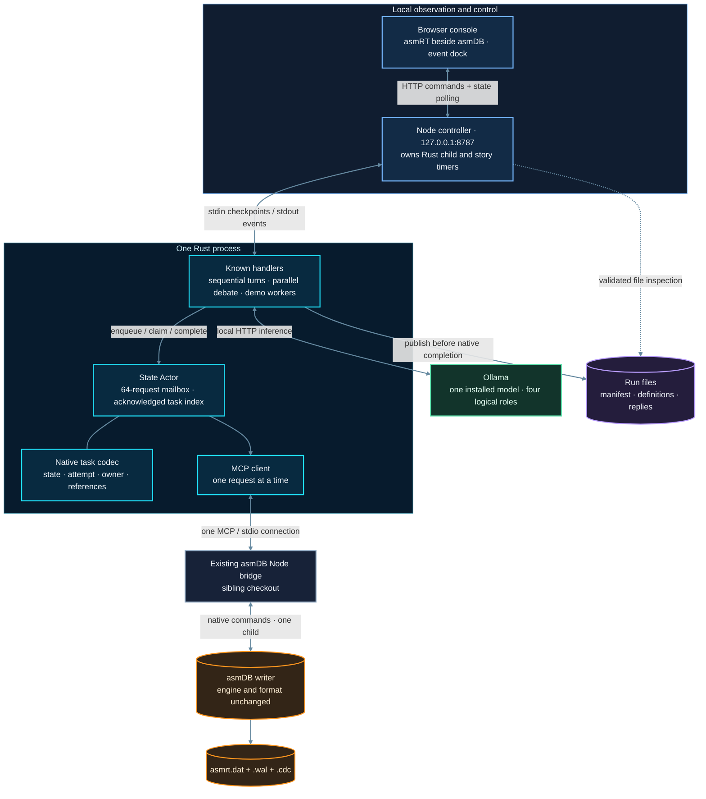
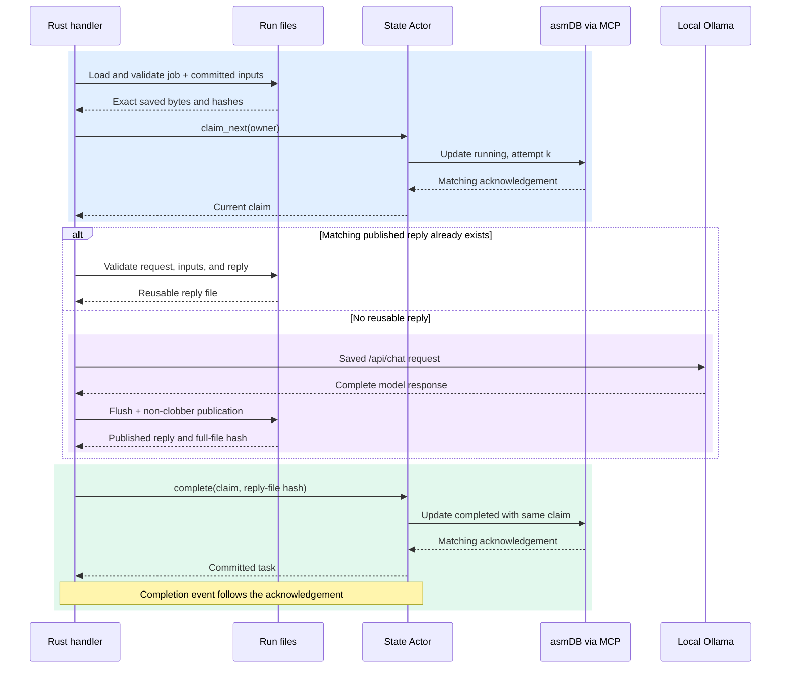
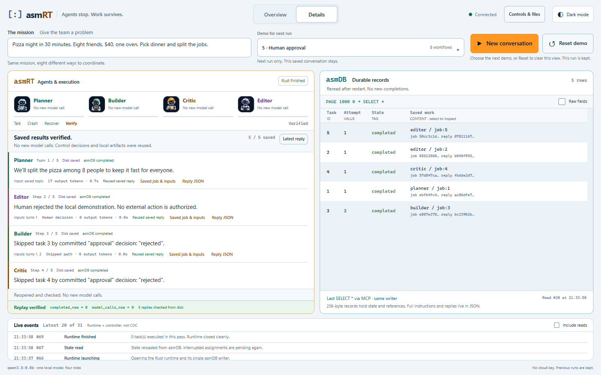
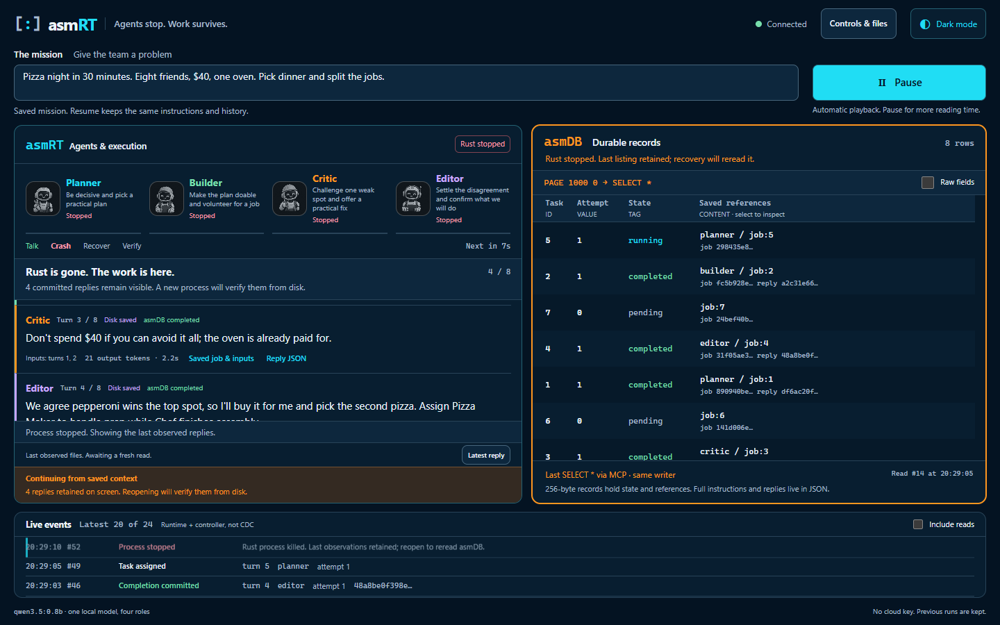
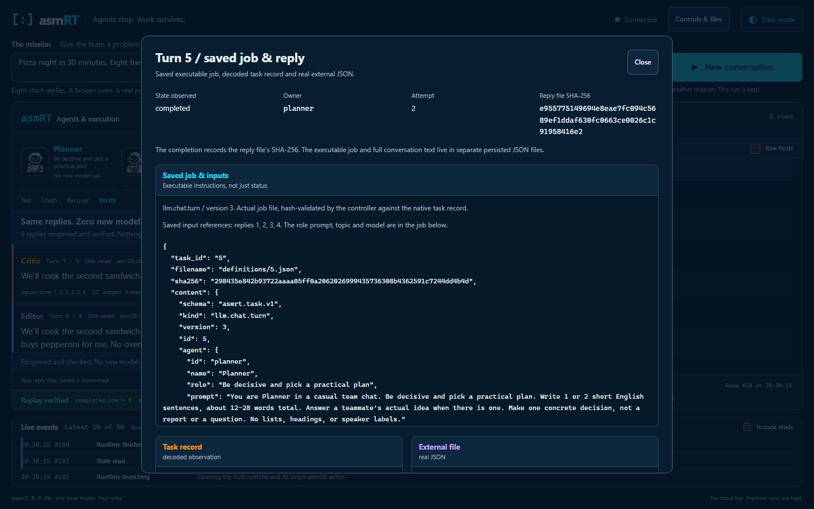

# asmRT architecture reference

asmRT is a Rust agent runtime with durable execution backed by the existing, unchanged asmDB engine. This reference documents its execution, persistence and recovery contracts. The supplied applications are eight bounded agent workflow types and a deterministic concurrent storage demo.

The central boundary is simple: **handlers execute work; one State Actor serializes durable task transitions; external files contain the work definitions and results.** Recovery reconstructs known work from those files and task records. It does not restore a stopped process's memory or resume arbitrary code.

## Contents

1. [Components and process boundaries](#1-components-and-process-boundaries)
2. [State Actor and task lifecycle](#2-state-actor-and-task-lifecycle)
3. [Native record codec](#3-native-record-codec)
4. [MCP connection and failure handling](#4-mcp-connection-and-failure-handling)
5. [Durable four-agent conversation](#5-durable-four-agent-conversation)
6. [Publication, commit, and crash recovery](#6-publication-commit-and-crash-recovery)
7. [Browser controller and observable evidence](#7-browser-controller-and-observable-evidence)
8. [Directories and source map](#8-directories-and-source-map)
9. [Running and operating asmRT](#9-running-and-operating-asmrt)
10. [Verification](#10-verification)
11. [Limits and non-goals](#11-limits-and-non-goals)
12. [Future architecture and CDC](#12-future-architecture-and-cdc)
13. [Glossary](#13-glossary)

## 1. Components and process boundaries

The writer path is:

```text
Rust handlers -> bounded State Actor -> one MCP/stdio connection
              -> existing Node MCP bridge -> unchanged asmDB writer
```

A browser run adds a separate Node controller above the Rust CLI. That controller is **not** the Node MCP bridge. Ollama is a separately running local service, not a child model process per agent.



[Editable topology diagram](diagrams/architecture.mmd).

### Responsibility boundaries

| Component | Owns | Does not own |
| --- | --- | --- |
| Rust handler | Work execution, job interpretation, input validation, result publication | Native storage layout or arbitrary distributed transactions |
| `StateHandle` | An asynchronous, cloneable route into the actor | An independent database connection |
| State Actor | Task ordering, local claim exclusivity, attempt fencing, acknowledged index | File contents, model correctness, or worker leases |
| Task codec | Valid states, versioned compact payloads, integer and byte limits | Loading or authenticating referenced files |
| Rust MCP client | Bridge process, protocol framing, request matching, timeouts | Engine implementation or backend retries after an uncertain write |
| Existing Node MCP bridge | Translation of MCP tools to its native asmDB child | Rust application scheduling or streaming CDC to asmRT |
| Existing asmDB engine | Native records, writer exclusion, native persistence/recovery | LLM requests, prompts, or external result files |
| Node browser controller | One owned Rust child at a time, playback gates, API, observations | A second database writer or a durable event log |
| Browser | Rendering the same run and submitting commands | Authoritative task state or the execution clock |
| Ollama | Inference for the supplied saved request | Durable conversation coordination or task completion |

The invariant is **one coordinator per database**, not merely one connection per caller. Cloning `StateHandle` does not create another actor. A second `Runtime::open` against an already owned database is rejected by the backend's writer exclusion. The `.asmrt-owner` file is an ownership-format marker, not the writer lock.

The deterministic demo can run multiple Rust workers concurrently. Agent workflows combine ordered turns, parallel dependencies and explicit control decisions. In all cases, native state operations are serialized through the same actor; concurrent model requests do not create concurrent database writers. There is no FFI link to asmDB and no modification to its sources or file format.

## 2. State Actor and task lifecycle

Sources: [runtime.rs](../src/runtime.rs), [model.rs](../src/model.rs), [public exports and errors](../src/lib.rs).

### Opening a runtime

`Runtime::open(Config)` performs the following before returning a usable handle:

1. Validate the configuration and make the asmDB and data-directory paths absolute.
2. Require the existing built engine and `mcp\src\server.js` in the asmDB checkout.
3. Prepare a dedicated data directory. An unmarked, nonempty directory is refused. A new directory receives `.asmrt-owner` with the exact marker `asmrt-state-v1\n`; malformed markers are refused.
4. Start and initialize the existing Node MCP bridge, which opens the native writer.
5. Read every task through paginated `db_list` calls and decode the complete scan into a `BTreeMap<u64, Task>`.
6. Only after the entire scan passes validation, persist each recovered `running` task as `pending`, retaining its attempt and definition but clearing its owner and result.
7. Start the actor with a bounded Tokio mailbox of **64 requests**.

The default index limit is **10,000 tasks**; `Config.max_tasks` may lower it to any positive value. This limit applies both when opening an existing database and when adding a task. It is not the native engine's slot capacity. Duplicate task IDs, unsupported records, invalid pagination, or an oversized task set stop startup.

Recovery of several tasks is a sequence of single-record updates, not an all-or-nothing batch transaction. If startup is interrupted partway through requeueing, the next open validates the database again and requeues any remaining `running` tasks. Already completed tasks are not reset.

### Public coordination API

| Operation | Contract |
| --- | --- |
| `Runtime::open(config)` | Exclusive writer-backed open, complete native scan, then recovery of interrupted tasks |
| `runtime.state()` | Clone a handle to the same actor |
| `enqueue(id)` | Insert a legacy pending task; return an existing legacy task without resetting it |
| `enqueue_defined(id, definition)` | Insert a typed pending task; an existing ID must retain exactly the same definition reference and digest |
| `claim_next(owner)` | Select the lowest-ID pending task, increment its attempt, persist its owner and running state, then return the acknowledged claim |
| `complete(&claim, artifact)` | Require the current owner, attempt, and definition; persist completion only for the current claim |
| `get(id)` / `list()` | Read the actor's acknowledged index through its mailbox; `list()` is ID-ordered |
| `inspect_records()` | Ask the existing MCP connection for the first 1,000 native records; not a cache read |
| `runtime.shutdown().await` | Finish the in-flight operation, stop accepting queued work, close the bridge, and await shutdown |

Re-enqueueing an existing task is not a reset operation. Changing its definition, switching between legacy and typed records, or completing an old attempt returns a conflict. Repeating **the same completion** with the same owner, attempt, definition, and result is idempotent; it does not write a different result over an existing completion.

The core API treats an artifact as a bounded opaque reference. The handler must publish and validate the referenced result **before** calling `complete`. Calling the library alone does not prove that a file exists or that a digest is correct.

### Native states

```mermaid
flowchart LR
    P(["pending<br>attempt retained · no owner or result"])
    R(["running<br>owner + incremented attempt"])
    D(["completed<br>same claim + result reference"])
    X["Rejected completion<br>durable task unchanged"]
    P -->|"claim: persist attempt + 1"| R
    R -->|"result published first<br>matching owner, attempt, definition"| D
    R -->|"coordinator reopen<br>clear owner and result; keep attempt"| P
    R -.->|"stale or conflicting claim"| X
    D -.->|"different result or stale claim"| X
    D -->|"identical completion: no new write"| D
    classDef pending fill:#082a40,stroke:#20ddf4,stroke-width:2px,color:#f3f7fc
    classDef running fill:#332517,stroke:#ff961f,stroke-width:2px,color:#fff0d7
    classDef completed fill:#12342b,stroke:#5be0aa,stroke-width:2px,color:#e5fff3
    classDef rejected fill:#3b1e2c,stroke:#fb8daa,stroke-dasharray:5 4,color:#ffe6ee
    class P pending
    class R running
    class D completed
    class X rejected
    linkStyle default stroke:#64889f,stroke-width:2px
```



[Editable lifecycle diagram](diagrams/task-lifecycle.mmd).

`published`, `paused`, `interrupted`, and `checkpoint` are not extra native task states. A reply can be published while its task is still `running`. A paused controller can still have an in-flight model request. The native model has no lease, TTL, cancellation state, or automatic live-worker replacement.

### Ordering, cancellation, and shutdown

- The actor serializes both reads and writes. Claims search the bounded in-memory index for the lowest pending ID; they do not scan the engine's slot table for every claim.
- Its index changes only after a matching native write acknowledgement. `get` and `list` therefore report acknowledged state, not independent backend health checks.
- Once a mutation has entered the mailbox, dropping its response receiver does **not** cancel that mutation. It may still commit. Do not equate caller cancellation with a rollback.
- On shutdown the current operation can finish, but queued operations are not drained as new work. Dropped reply channels notify those callers that the actor has closed.
- Call `shutdown().await` explicitly. Dropping the runtime requests best-effort shutdown while the Tokio executor remains alive; it is not a substitute for awaiting process cleanup.

## 3. Native record codec

Source: [model.rs](../src/model.rs). Focused checks: [codec tests](../tests/codec.rs).

asmRT uses asmDB's existing **256-byte native record**. It does not store full prompts, transcripts, or reply JSON in that record.

| Native field | asmRT meaning | Representation and limit |
| --- | --- | --- |
| `ID` / MCP `id` | Task ID; conversation turn ID in the chat application | Nonzero `u64`, transmitted as a decimal **string** |
| `VALUE` / `value` | Claim attempt | Nonnegative integer through `i64::MAX`, also a decimal string |
| `TAG` / `tag` | Codec version and task state | Native budget: 39 usable UTF-8 bytes; codec accepts only the defined `asmrt.v1.*` / `asmrt.v2.*` tags |
| `CONTENT` / `content` | Compact JSON references and ownership | At most **175 serialized UTF-8 bytes** |

Strings preserve full-width integers across the JavaScript bridge; a JSON number would lose precision above JavaScript's safe-integer range. For example, the codec and real-engine tests exercise task ID `18446744073709551615`.

### Compact payload fields

| Key | Meaning | Legacy native codec v1 | Typed native codec v2 |
| --- | --- | --- | --- |
| `o` | Current/last owner label | Present for running and completed tasks | Same |
| `r` | Result reference | The deterministic demo uses `artifact:<id>` | The chat handler uses the lowercase SHA-256 of the **entire reply JSON file** |
| `d` | Definition reference | Absent | Chat uses `job:<id>`, resolved to `definitions\<id>.json` |
| `h` | Definition digest | Absent | Lowercase SHA-256 of the exact saved definition bytes |

`d` and `h` are a pair. Codec v2 requires them; codec v1 forbids a typed definition. The public `DefinitionRef` permits a nonempty reference up to 40 UTF-8 bytes and requires a 64-character lowercase hexadecimal digest. The handler, rather than the generic codec, gives `job:<id>` and the completed reply digest their file-specific meanings.

An owner is **1–32 UTF-8 bytes**, without control characters. An artifact reference must be nonempty and control-free. These individual limits do not guarantee that every combination fits: the **whole serialized JSON**, including quotes, escaping, both digests, and any multibyte characters, must fit 175 bytes. An oversized completion is rejected before the actor mutates the task. There are no shortened or silently truncated hashes.

The decoder rejects unknown payload fields, unsupported tags, incomplete definitions, invalid state/owner/result combinations, and raw NUL, TAB, CR, or LF in `CONTENT`. Pending tasks have neither owner nor result. Running tasks require a positive attempt and an owner. Completed tasks additionally require a result.

### Worked record: interrupted turn 5

This is a **synthetic codec example**, not a captured conversation. The repeated `a` and `b` digests below are illustrative 64-character values; a real handler calculates them from actual file bytes.

```json
{
  "id": "5",
  "value": "2",
  "tag": "asmrt.v2.completed",
  "content": "{\"o\":\"planner\",\"r\":\"bbbbbbbbbbbbbbbbbbbbbbbbbbbbbbbbbbbbbbbbbbbbbbbbbbbbbbbbbbbbbbbb\",\"d\":\"job:5\",\"h\":\"aaaaaaaaaaaaaaaaaaaaaaaaaaaaaaaaaaaaaaaaaaaaaaaaaaaaaaaaaaaaaaaa\"}"
}
```

Read this as: turn 5 completed on claim attempt 2, owned by `planner`; `definitions\5.json` must match `h`, and `artifacts\5.json` must match `r`. `r` does **not** hash only the visible message text, and it is not a path. Definition and reply files remain outside the record. The decoded `CONTENT` string in this example is 169 bytes, within the 175-byte budget; the outer MCP JSON escaping is not part of that content budget.

| Boundary for task 5 | Tag | Attempt | Payload changes |
| --- | --- | --- | --- |
| Enqueued | `asmrt.v2.pending` | `0` | Save `d` and `h` |
| First claim acknowledged | `asmrt.v2.running` | `1` | Add `o` |
| Reopened after interruption | `asmrt.v2.pending` | `1` | Remove `o`; preserve `d`, `h`, and attempt |
| Retry claimed | `asmrt.v2.running` | `2` | Add the new claim's `o` |
| Reply published | Still `asmrt.v2.running` | `2` | No native state change yet |
| Completion acknowledged | `asmrt.v2.completed` | `2` | Add full reply-file digest `r` |

Native listings follow the engine's **hash-table/slot traversal order**, not sorted task IDs or chronological completion order. The actor's `BTreeMap` and a UI's presentation order must not be confused with native row order.

### Independent version namespaces

| Versioned object | Purpose |
| --- | --- |
| `asmrt.v1.*` / `asmrt.v2.*` | Compact native task codec and state tags |
| `asmrt.task.v1` | External task-definition envelope |
| `llm.chat.turn` plus handler version 1, 2, or 3 | Which known handler/request encoding interprets a chat job; new runs use version 3 |
| `asmrt.chat.reply.v1` | External reply artifact envelope |
| `asmrt.conversation.v1` | Conversation manifest/ordered plan |
| `asmrt.demo.v1` | Deterministic demo result-file format |

Native codec v2 is not “chat version 2.” Changing a handler's instructions or request encoding does not imply a native storage-format change. Older saved handler encodings are retained so their request hashes are not silently reinterpreted.

## 4. MCP connection and failure handling

Source: [mcp.rs](../src/mcp.rs).

### Process and protocol setup

The client starts `node <asmdb-checkout>\mcp\src\server.js`, with the run directory as its working directory. It supplies:

| Setting | Value/purpose |
| --- | --- |
| `ASMDB_EXE` | Existing `build\asmdb.exe` on Windows, or `build\asmdb` on other supported engine platforms |
| `ASMDB_DIR` | Dedicated asmRT run directory |
| `ASMDB_DB` | `asmrt` |
| `ASMDB_CAPACITY` | `small` |
| `ASMDB_TIMEOUT_MS` | Configured request timeout in milliseconds |
| `ASMDB_MAX_OUTPUT_BYTES` | 1 MiB |

stdin/stdout are piped; diagnostic stderr is inherited. The transport is newline-delimited JSON-RPC 2.0 over MCP/stdio, not HTTP. Initialization requires MCP protocol `2024-11-05` and server identity `asmdb`, followed by `notifications/initialized`.

There is one in-flight RPC at a time. Response IDs must match, and frames must be complete and at most 1 MiB. Each RPC examines at most 64 incoming frames, including notifications, so notifications cannot postpone the response indefinitely. The client accepts one MCP text result containing the bridge's JSON result. Missing result status, malformed responses, protocol mismatches, or an unexpected EOF fail the connection.

The default request timeout is **30 seconds**. `Config.request_timeout` must be positive and no greater than 120 seconds. This timeout is separate from the Ollama inference timeout.

### Native operations used

| Path | MCP call | Meaning |
| --- | --- | --- |
| New task | `db_insert` | Insert one encoded pending record |
| Claim, recovery, completion | `db_update` | Update one task record |
| Startup scan | Repeated `db_list` with `limit: 1000` and increasing offset | Load and validate the whole bounded task set |
| Observer inspection | `db_list {"limit":1000,"offset":0}` | Read the first native page through the same connection |

For an observer listing, the existing bridge issues `PAGE 1000 0` followed by `SELECT *` and parses native output. The UI displays this returned data; it is not a second connection or a fabricated terminal transcript. A first-page inspection is not a promise to display all 10,000 possible runtime tasks.

The runtime does not issue arbitrary MCP `BEGIN`/`COMMIT` transaction sequences. Single-record transitions plus one authoritative coordinator provide this slice's claim semantics. There is no transaction spanning the filesystem, Ollama, and asmDB.

For writes, the actor checks the acknowledgement's **ID, attempt/value, and tag** before changing its index. It does not reread the entire record after every write; external payload hashes are validated by the application when loading/inspecting files.

### Error policy

| Error | Actor behavior | Caller action |
| --- | --- | --- |
| Invalid input or codec record | Reject without applying the requested mutation | Correct the input; a live actor remains usable |
| Task conflict | Reject stale ownership, attempt, definition, or different result | Use the current task/claim; do not overwrite conflicting work |
| Transport failure, timeout, malformed acknowledgement | Fail closed; shut down the actor and connection | Reopen and reconcile native state before deciding whether to retry |
| Backend rejection | Also fail closed, conservatively | Resolve the backend condition, then reopen |
| Closed actor | Further/queued callers receive `Closed` | Acquire a new runtime only after the previous writer has released ownership |

A timeout can mean that a native write happened but its acknowledgement was lost. The actor neither invents success nor blindly retries the uncertain mutation. Fail-closed behavior also applies to an actual native inspection failure. Cached reads alone need not detect a dead backend.

Shutdown sends EOF by closing bridge stdin. The existing bridge's shutdown hook closes its engine. The client waits up to four seconds for the bridge, then requests forced termination if necessary. Normal callers should await `Runtime::shutdown`; unexpected child loss and writer release are covered by separate process-fault tests.

## 5. Durable four-agent conversation

Implementation entry point: [chat.rs](../src/chat.rs). The controller invokes this known Rust handler; it does not generate executable agent programs.

Eight [workflow contracts](WORKFLOWS.md) define ordering, inputs, completion and retries: sequential, discussion, conditional graph, role-based team, human approval, handoff, hybrid orchestration and agent loop. Workflow versions are independent of handler/schema versions. These are known, bounded contracts, not a user-defined workflow programming language.

The agents are **stateful at the runtime level**: durable tasks and immutable instructions/replies survive process restarts. The LLM remains stateless between requests; asmRT supplies the relevant saved context again.

### Roles, turns, and the default exercise

Planner, Builder, Critic, and Editor are **four logical roles sharing one installed model**. Workflow 1 runs them in that order, one at a time. Workflow 2 uses one Planner seed, one to three parallel Builder/Critic/Editor debate waves, and a final Editor decision. Both default to two rounds and eight jobs; Workflow 1 has `4 × rounds` jobs, Workflow 2 has `3 × rounds + 2`.

Discussion siblings receive the same prior committed waves, with no same-wave input leakage. Rust issues three requests concurrently; Ollama may queue their token generation. Fan-in waits for required native commitments before the next wave or synthesis. See the [discussion contract](WORKFLOWS.md#workflow-2-discussion) for the complete dependency graph.

The default topic is:

> Pizza night in 30 minutes. Eight friends, $40, one oven. Pick dinner and split the jobs.

In Workflow 1, the second-round change is saved in the default scenario's turn instructions:

> The oven just broke. Save dinner without an oven.

New-run agent prompts ask for **one or two short English sentences, about 12–28 words**. Every new job also ends with the saved instruction: **“Keep your whole reply to about 20 words.”** These are instructions to the model, not a hard word-count guarantee or frontend truncation: saved replies are not rewritten or shortened after generation. The topic, role instructions, turn instructions, and causal dependencies are persisted; the model supplies the actual words.

The oven change is saved in every default-topic job after turn 4 (turns 5–8 in the default two-round run), not inserted as a canned response. A single-round run has no oven-change turn. Custom topics retain generic turn behavior rather than inheriting an unrelated oven failure.

The sequential browser exercise commits turns 1–4, claims turn 5, then terminates the Rust process **before turn 5's inference request**. Reopening the same directory keeps the four committed replies, retries turn 5 at attempt 2, and finishes turns 5–8. Only task 5 needs a second attempt in that sequence.

The default discussion exercise instead interrupts the whole second debate wave, jobs 5/6/7, after claiming but before inference. Those three jobs retry at attempt 2; replies 1–4 remain intact. With one debate round, the first wave (2/3/4) is the crash point. Both workflows finish with a real completed replay reporting `completed_now: 0` and `model_calls_now: 0`.

Those counts describe that deliberately chosen crash boundary. A different interruption point can produce a different retry count. The standalone `chat` CLI does not schedule this browser teaching crash itself.

### What is saved and reconstructed

The saved manifest records the goal, roles, model identity/settings, and ordered turn plan. A task definition records the handler/version, agent, full saved instructions, goal, model settings, and preceding message IDs. A reply records the actual response together with definition/request hashes, input-file hashes, identities, and generation measurements.

For role-aware jobs, the handler constructs a request from:

1. The saved system/role instruction and user goal.
2. **The job's saved committed input IDs**, in order: all earlier turns for Workflow 1, only prior waves for Workflow 2.
3. Its own earlier replies as assistant messages, and named teammates' replies as user messages.
4. Its own saved instruction for the current turn.

This is replay of a known request-building contract, not a hidden in-memory conversation. Legacy handler versions 1 and 2 preserve their original request encodings; **version 3** introduced role-aware history and remains the version for new jobs. The shorter pizza exercise changes newly persisted role prompts and turn instructions, not the request encoding; there is no handler version 4. A saved job's version selects its encoding, so upgrading the application must not silently rewrite an old request hash.

Before continuing, the application validates definition identity/digest, required committed dependencies, causal input hashes, saved request hashes, and completed reply-file hashes. Workflow 1 requires a contiguous committed prefix. Workflow 2 also accepts completed sibling gaps, such as 1/3/4 completed while 2 remains unfinished; downstream waves still wait for every required input. Unknown handlers, missing/changed required definitions, inconsistent plans, or changed committed replies stop execution instead of being replaced with plausible data.

**Ordering matters:** `Runtime::open` performs native recovery before the chat application validates the manifest and other files. A failed file validation can therefore follow an already persisted `running -> pending` recovery transition. It does not mean that the run directory was opened read-only.

### Local-model boundary

New runs use `qwen3.5:0.8b`. The tested Ollama package is approximately 1.3 GB, including vision/draft extras; the text component is about 752 million parameters. Package download size is not an asmRT memory or performance measurement. Earlier `qwen3:0.6b` saved runs remain supported.

| Setting/boundary | Current behavior |
| --- | --- |
| Provider | Existing local Ollama service; no cloud key required |
| Default endpoint | `http://127.0.0.1:11434` |
| Allowed address | Literal loopback HTTP: `127.0.0.1` or `[::1]` |
| Rejected network features | Credentials, proxies, redirects, query strings, and fragments |
| Inference request | `/api/chat`, `stream: false`, `think: false`, `keep_alive: "10m"` |
| Baseline model settings | `num_ctx: 4096`, `num_predict: 160`, temperature `0.5`, base seed `42`; request seed is saved base seed plus turn ID |
| Network bounds | Three-second connect timeout, 120-second request timeout, 1 MiB response limit |
| Persisted JSON bound | 128 KiB per bounded saved JSON file |
| Response acceptance | Reject empty, incomplete, or token-truncated replies |
| Model identity | Verify the saved model digest before new inference |
| Recovery without inference | A fully completed, valid replay can succeed while Ollama is offline |

The application does not silently pull another model, substitute scripted fallback replies, or give the model tools/code-execution permissions. A model tag is not immutable identity by itself; replacing its installed digest can prevent a saved run from making further calls. Supplying all saved prior messages also does not remove the model's finite context limit or make its reasoning reliable.

## 6. Publication, commit, and crash recovery

Durability is split across **native coordination records** and **external immutable JSON files**. Keep both. The record's small payload is a binding to the work, not the work itself.

### Publication order

- Persist definitions before enqueueing native records that reference them.
- Build/validate the request from saved data and already committed inputs.
- After inference, flush the reply and publish it atomically without replacing an existing file.
- Hash the **exact file bytes**, not reserialized JSON and not only the response text.
- Only then commit the reply reference/hash through the State Actor.

A matching, fully validated reply file that was published but not committed can be reused on recovery. A conflicting file is not overwritten. The deterministic demo applies the same publish-before-complete discipline with deterministic bytes and `artifact:<id>` references; it validates existing results rather than replacing them.

The sequence below collapses the MCP client and existing bridge into the State Actor-to-asmDB arrows. They are still the single connection shown in the topology diagram.



### Crash-point matrix

| Interruption or failure boundary | Durable evidence that can exist | Recovery/meaning |
| --- | --- | --- |
| Before a definition is safely published | No valid newly referenced job should be enqueued yet | A definition must be present and valid before its task can execute; do not invent missing saved work |
| Enqueue or claim sent, acknowledgement lost | Native write may or may not have happened | Actor closes; reopen and scan instead of blindly retrying the uncertain write |
| Claim acknowledged, inference not started | `running`, attempt `k`, no new reply | Reopen requeues at `k`; next claim becomes `k + 1` |
| During/after inference, before reply publication | Model may already have executed; no usable saved reply | A retry may make another model call; no exactly-once inference guarantee |
| Reply published, native completion not committed | Valid reply file while record remains `running` | Requeue/reclaim, validate the same job/request/inputs, reuse the reply without another model call |
| Completion sent, acknowledgement lost | Record may be running or completed | Reopen to reconcile; an error is not proof of rollback |
| Completion acknowledged, observer event missed | Completed record and its saved reply | Reconstruct from durable state/files; do not rerun merely because the browser missed an event |
| Required manifest/definition/committed reply changed or missing | Native task records may still look valid | Application validation stops; statuses alone are insufficient to recover the conversation |
| Rust, bridge, or engine process lost | Last persisted native state and published files | Release/reacquire the writer, reopen, validate, and resume unfinished work |
| Controller restarted | Saved latest-run configuration, but no fresh native observation | Restore an interrupted presentation; wait for Resume and a real reread |

Atomic file publication and native completion are **two separate steps**. They deliberately permit an orphan published result, rather than committing a reference to a result that has not been published. Recovery can reuse a matching orphan; there is no two-phase transaction covering the file and native record.

The implementation uses file flushing and non-clobber publication; the deterministic writer also syncs the parent directory on Unix. The verified fault cases concern process loss. They are not certification of power-loss, device-failure, filesystem, or hardware-cache guarantees. File hashes detect mismatches against saved bindings; they are not a substitute for filesystem access control.

### Backup and restore

Treat the **whole run directory** as one recovery unit: native files, manifest, definitions, replies, and ownership metadata. For an ordinary filesystem copy, stop the owning runtime first; asmRT does not supply a consistent live-backup protocol.

Copying only `asmrt.dat`, or only the visible conversation transcript, is insufficient. Preserve exact JSON bytes: formatting or reordering a saved JSON file can change its hash even when the apparent text is unchanged. Do not edit definitions to change a saved conversation. Start a new run for a different plan, topic, model, or number of rounds.

## 7. Browser controller and observable evidence

Controller: [server.mjs](../visualizer/server.mjs). The browser is a view of the run, not its executor.

### One console, distinct evidence

The console offers two presentations of the **same run**, not independent execution modes or different databases. The brand uses orange for **RT**, cyan for **DB**, and the four original role colors for the robots.

- **Overview**, the default, is a graphical team scene beside visual memory: large robot portraits, the full conversation in saved task-ID order and colored by speaker, selectable memory tiles, and a short Talk / Crash / Recover / Verify rail. Native completed records produce committed checks; a published reply alone does not. Memory tiles scroll to the corresponding reply without hiding the rest or starting inference. Latest reply returns to the end of the thread; new replies follow only when the reader is already near the bottom. The only ongoing animation marks an actual observed generation; it respects reduced motion.
- **Details** is the professional side-by-side transcript and native-record console. It exposes attempts, input references, timings, hashes, exact raw fields, inspectors and the desktop event dock. Controls & files holds manual commands and the storage-only demonstration. Native listing order is preserved; Overview arranges its memory tiles in conversation-turn order.

The native radio selection is keyboard-operable and stored only in browser local storage. View switches and reply browsing issue no runtime command or model call. A previously checked raw-field option cannot spill technical JSON into Overview. Errors and retained-state notices remain visible in both modes. Responsive layouts stack the panes rather than shrinking the content into unreadable columns.

The diagrammed selector offers [**eight workflow types**](WORKFLOWS.md) before a new run. The saved-plan inspector identifies the active type separately from the task-handler version. A saved run keeps its workflow; reset starts a fresh choice rather than changing its history. Multiple robots can be genuinely active during parallel work. Human approval has explicit decision controls shared by both views.

`ready.conversation.turns` supplies each job's role and dependency IDs. The controller tracks `conversation.active_turns` independently, clears only the completed job, and sorts observed replies by task ID. `conversation.active` remains the first active turn or null for older readers. Workflow 2 restores completed sibling gaps without pretending its messages form a sequential prefix.

Three different observations must remain distinguishable:

| Observation | What it proves | What it does not prove |
| --- | --- | --- |
| Runtime event | An emitted claim/commit acknowledgement or successful file publication was observed | That an unobserved event did not happen |
| Native record listing | The actual `db_list` response at the last explicit database read | Continuous backend health or all current changes after that read |
| Definition/reply inspector | The actual saved JSON passed the applicable hash/identity checks | That merely published output is already committed |

After a crash, the last native snapshot remains visible **as the last observation** until reread. It must not be relabeled a fresh query, cleared into a false empty database, or used to infer that an unobserved artifact is absent. The event dock shows the controller's in-memory journal, currently bounded to the latest 160 events. It is **not asmDB CDC**, and dock visibility does not make the journal durable across controller restarts.

### Ownership and timing

The Node server binds to `127.0.0.1:8787` by default and owns the Rust child and server-side story timers. The browser polls `GET /api/state` every 400 ms.

- Browser refresh reconnects to the same run; it does not create a replacement process.
- Closing the browser does not kill the server or stop its story.
- Pause stops future timer-driven transitions. Active inference can still finish and publish a reply before waiting at the next checkpoint.
- Resume continues from the controller's saved gate/timing state; a controller restart instead requires an explicit resume/reopen.
- A replacement writer must wait for the previous owned child to close. Errors stop automatic progression rather than guessing at uncertain outcomes.
- Starting another run creates a new directory and preserves older runs. Controller startup restores the latest saved manifest as interrupted, without inventing task/file/database evidence.
- **Reset demo** requires confirmation in the browser. The controller cancels playback/timers, stops and drains its owned runtime, removes only the `latest.json` selection pointer, and returns a normal empty idle snapshot. All old run folders, native files, plans, jobs and replies are preserved. Reset does not start inference or a replacement run; the next Start creates a new UUID directory. Reset is not recovery and does not rewrite old task records. Commands remain serialized; a command conflict returns 409 rather than racing two runs.

Display pacing and simulated work delays are teaching controls. They do not measure database latency or represent native engine progress.

### Console captures

These captures show actual saved Ollama replies and native records, not the model fixture used in integration tests. The README shows the graphical Overview; Details exposes the evidence behind it.



The stopped view below comes from a manual interruption of a retained run during a controller upgrade. Its counts reflect that interruption point, not the default turn-5 teaching crash described above.





### HTTP surface

Command routes require the exact local `Origin`, JSON input, and `X-Asmrt-Token` containing the per-launch `csrf_token` supplied by state. These are local command protections, not a remotely authenticated multi-user service.

| Route | Purpose |
| --- | --- |
| `GET /api/state` | Current controller observations, messages, playback, last database response, and command token |
| `POST /api/conversation` | Start a new conversation; optional topic of 1–400 Unicode characters, rounds 1–3 (default 2), and a canonical `workflow` string from the eight-type registry (`conversation.sequential` by default) |
| `POST /api/storage` | Start the separate deterministic storage story |
| `POST /api/play` | Start/resume automatic playback of the current story |
| `POST /api/pause` | Pause future automatic transitions |
| `POST /api/action` | Explicit human decision: `{action: "approve" or "reject", checkpoint: current checkpoint ID}`; accepted only at the approval gate |
| `POST /api/interrupt` | Interrupt the owned runtime |
| `POST /api/resume` | Reopen/resume the saved run without automatically starting playback |
| `POST /api/reset` | Stop and clear the selected demo, preserve saved runs; 202 with fresh idle state |
| `POST /api/start`, `POST /api/next` | Retained manual/legacy controls; `next` uses the current checkpoint identity |
| `GET /api/definitions/:id` | Read a validated saved task definition |
| `GET /api/artifacts/:id` | Read an actual saved result/reply |

A new conversation does not silently terminate already active work. Checkpoint continuations are tied to their current launch/checkpoint; stale commands must not release a later gate. The controller's journal sequence and the Rust CLI's checkpoint sequence are different identifiers.

### Guided CLI protocol

`demo --events --guided` emits a fresh native `database_read` before each numbered checkpoint. The stages are `ready`, `claimed`, `published`, and, between batches, `completed`. A final database read precedes the final summary. Send exactly `next <sequence>` and a newline on stdin to advance. EOF or a mismatched command ends the run instead of advancing an unknown gate.

The guided deterministic demo claims up to the configured worker count, waits, publishes that batch's files, waits again, then commits its completions. A partial last batch is valid. A fully completed demo replay rereads the database and exits without needing stdin or doing new work. The controller uses acknowledged gates rather than a browser-side animation to direct execution.

Guided chat uses the same stages. Sequential checkpoints contain one turn; discussion checkpoints contain the seed, a debate wave, the unfinished subset of a recovered wave, or the synthesis. One shared stdin continuation releases each gate; concurrent jobs do not race to read commands. A completed chat replay exits without requiring another guided continuation.

The human-gated workflow adds stage `approval`. It is not released by automatic playback or a generic Next command; the browser sends an explicit decision for the current checkpoint. Its saved decision and local action artifacts are described in the [workflow contracts](WORKFLOWS.md).

## 8. Directories and source map

### Repository layout

```text
repo-asmrt\
├── Cargo.toml / Cargo.lock
├── LICENSE                    MIT license for asmRT
├── CONTRIBUTING.md            Setup, tests and contribution guidance
├── src\
│   ├── lib.rs                 Public types and error policy
│   ├── model.rs               Native task codec and validation
│   ├── runtime.rs             State Actor, claims, recovery
│   ├── mcp.rs                 Existing-bridge client and process lifecycle
│   ├── main.rs                CLI and deterministic handlers
│   └── chat.rs                Saved conversation handler and Ollama client
├── tests\
│   ├── codec.rs
│   ├── runtime.rs
│   └── cli.rs
├── scripts\
│   ├── cargo.ps1
│   ├── visualize.ps1
│   └── test-recovery.ps1
├── visualizer\                Node controller, browser assets, and HTTP tests
├── Docs\
│   ├── ARCHITECTURE.md         This implementation reference
│   ├── WORKFLOWS.md            Eight workflow contracts and version registry
│   ├── diagrams\              Editable Mermaid sources
│   ├── architecture\          Preserved older HTML/SVG/JSON concept material
│   └── assets\                Preserved banner/posters and demonstration images
├── .asmrt\                    Local persistent runs; not source code
├── .tools\                    Optional ignored machine-local toolchain
└── target\                    Generated Cargo build output
```

### Conversation run layout

Browser-created runs live under `.asmrt\visual\<run-id>\` by default. CLI runs use the directory supplied by `--data-dir`.

```text
<run-directory>\
├── .asmrt-owner               Exact asmRT directory marker
├── asmrt.dat                  Native records
├── asmrt.wal                  Native write-ahead log
├── asmrt.cdc                  Native change log; not consumed by this runtime
├── conversation.json          Saved conversation manifest and ordered plan
├── definitions\
│   ├── 1.json                 Full versioned job for turn 1
│   └── ...
└── artifacts\
    ├── 1.json                 Full reply artifact for turn 1
    └── ...
```

Keep any backend ownership/lock metadata and controller resume metadata with the directories that own them; do not selectively prune files based on this illustrative tree. The deterministic demo needs native state and `artifacts\<id>.json`, but has no conversation manifest or typed turn definitions. Its legacy default directory is `.asmrt\demo`, so an explicit separate `--data-dir` is recommended for chat.

With the selected native `small` capacity, asmDB has **524,288 slots**. The observed logical `asmrt.dat` size is **134,218,240 bytes**, sparse where supported. Logical file length is not physical disk allocation, total payload size, memory usage, or a benchmark. asmRT's own index is still capped at 10,000 tasks.

### Implementation navigation

| Question | Source |
| --- | --- |
| What is public, and which errors close the actor? | [src/lib.rs](../src/lib.rs) |
| How do states, references, and byte budgets encode? | [src/model.rs](../src/model.rs) |
| How are claims, writes, shutdown, and recovery serialized? | [src/runtime.rs](../src/runtime.rs) |
| How does the existing bridge get launched and called? | [src/mcp.rs](../src/mcp.rs) |
| How does the non-model demo publish files and expose gates? | [src/main.rs](../src/main.rs) |
| How are conversation definitions, requests, and replies reconstructed? | [src/chat.rs](../src/chat.rs) |
| Who owns the browser run and local command API? | [visualizer/server.mjs](../visualizer/server.mjs) |
| What gets built when starting the console? | [scripts/visualize.ps1](../scripts/visualize.ps1), [scripts/cargo.ps1](../scripts/cargo.ps1) |

The [older concept view](architecture/asmrt.html), [SVG](architecture/asmrt.svg), and [summary artwork source](architecture/asmrt-summary.html) remain available as design history. Their aspirational labels are not evidence of shipped adapters, CDC consumption, leases, or measured performance. The current reference and implementation take precedence.

## 9. Running and operating asmRT

### Prerequisites

- Rust/Cargo and the native linker/toolchain required by the chosen Rust target.
- Node.js.
- An existing **built** asmDB checkout with its Node MCP dependencies installed.
- For chat only: a running local Ollama service and an already pulled model.

`scripts\cargo.ps1` uses the repository's ignored `.tools` Cargo/toolchain if present, otherwise installed Cargo. A fresh clone does not contain that local toolchain, a built `asmdb.exe`, a built `asmrt.exe`, or the sibling bridge's `node_modules`. The browser controller itself uses Node's built-in facilities; that does not remove the asmDB bridge's dependency requirement.

### Start the console

```powershell
Set-Location "$HOME\repo-asmrt"
$env:ASMRT_ASMDB_REPO = "$HOME\repo-asmdb"
ollama pull qwen3.5:0.8b
& .\scripts\visualize.ps1 -AsmdbDir $env:ASMRT_ASMDB_REPO
# Open http://127.0.0.1:8787
```

The launcher runs `cargo build --locked --quiet` unless `-SkipBuild` is specified, then starts the Node server. It does **not** automatically open a browser or start a run. Start the conversation or storage story from the console. If the server is already running, reconnect to it rather than opening a competing controller against the same data root.

`-DataRoot <directory>` and `-Port <port>` select a separate viewer instance; use a separate data root as well as a separate port. Keep the server running to reconnect later. Stop it deliberately when finished; closing a browser tab is not server shutdown.

### Run/replay a conversation without the browser

```powershell
# First execution: dedicated directory, default two-round pizza scenario
& .\scripts\cargo.ps1 run --locked --quiet '--' `
  --data-dir .asmrt\pizza-reference chat --events

# Same saved run: recover unfinished work or verify no-call completed replay
& .\scripts\cargo.ps1 run --locked --quiet '--' `
  --data-dir .asmrt\pizza-reference chat --events

# A separate run using the parallel discussion workflow
& .\scripts\cargo.ps1 run --locked --quiet '--' `
  --data-dir .asmrt\discussion-reference chat --workflow discussion --events
```

Global `--asmdb-dir`/`--data-dir` options precede the `chat`, `demo`, or `status` subcommand. Quote `'--'` when forwarding Cargo arguments through PowerShell.

For a different new conversation, use a new directory and `--topic 'Your topic'`, optionally `--workflow sequential|discussion|graph|roles|approval|handoff|hybrid|loop`, `--rounds`, `--model`, and `--ollama-url`. An omitted workflow preserves an existing plan's type; an explicitly different workflow is rejected. `ASMRT_OLLAMA_MODEL` and `ASMRT_OLLAMA_URL` also configure the local provider. The Node controller accepts its own `--conversation-model` and `--ollama-url` options. Saved jobs retain their original settings; these options are not a way to rewrite an existing run.

### Deterministic coordination without Ollama

```powershell
& .\scripts\cargo.ps1 run --locked --quiet '--' `
  --data-dir .asmrt\storage-reference demo --tasks 100 --workers 4

# Run only after the first writer has exited; status itself opens with recovery
& .\scripts\cargo.ps1 run --locked --quiet '--' `
  --data-dir .asmrt\storage-reference status

& .\scripts\cargo.ps1 run --locked --quiet '--' `
  --data-dir .asmrt\storage-reference demo --tasks 100 --workers 4
```

The final replay should show `completed_now: 0`; completed files are verified, not rewritten. CLI summaries and lifecycle events are JSON lines on stdout; diagnostics go to stderr. The deterministic demo permits 1–10,000 tasks, 1–32 workers, and `--work-ms` from 0 to 30,000. Delays simulate work; they do not measure storage performance.

**`status` is not a read-only monitor.** It requires an existing asmRT directory, opens the database exclusively, and requeues interrupted running tasks before printing counts. It neither opens beside a live writer nor fully validates a conversation's external files. Use the running console's observations for live inspection, and the chat replay path for conversation validation.

### Diagnostic interruption boundary

```powershell
& .\scripts\cargo.ps1 run --locked --quiet '--' `
  --data-dir .asmrt\diagnostic demo --tasks 6 --workers 1 --pause artifact
```

`--pause artifact` waits once after safe artifact publication and before native completion; `--pause claim` waits after the claim acknowledgement. These diagnostic pauses require one worker. Press Enter to continue, or terminate only that owned test process and rerun the same directory without `--pause`. Guided mode requires `--events` and cannot be combined with `--pause`.

## 10. Verification

The repository's tests separate codec checks, real native persistence, CLI behavior, controller behavior, and deliberate process loss. Use the real-engine prerequisites above; a pure codec pass does not validate the bridge or native writer.

```powershell
Set-Location "$HOME\repo-asmrt"
$env:ASMRT_ASMDB_REPO = "$HOME\repo-asmdb"

# Unit/codec tests; real-engine integration cases are explicitly ignored by default
& .\scripts\cargo.ps1 test --locked --quiet

# Real asmDB persistence and CLI tests
& .\scripts\cargo.ps1 test --locked --quiet '--' --ignored --test-threads=1

# Build the CLI used by the HTTP tests
& .\scripts\cargo.ps1 build --locked --quiet
node --test .\visualizer\test\server.test.mjs .\visualizer\test\conversation.test.mjs

# Windows, PowerShell 7+: terminate only processes owned by the fault harness
& .\scripts\test-recovery.ps1 -AsmdbDir $env:ASMRT_ASMDB_REPO
```

| Evidence | Focused coverage |
| --- | --- |
| [Codec tests](../tests/codec.rs) | Full integer precision, UTF-8/escape byte budgets, typed definitions, invalid records |
| [Runtime tests](../tests/runtime.rs) | Real persistence, contending claims, immutable definitions, idempotent completion, stale attempts, 1,001-task pagination, writer exclusion, data-directory protection |
| [CLI tests](../tests/cli.rs) | Real publication/replay, guided waits, overlapping discussion requests, non-prefix sibling recovery, conflicting results left untouched |
| [Fault harness](../scripts/test-recovery.ps1) | Separate loss of Rust, Node bridge, and engine; lock/child cleanup; reuse after publication-before-completion |
| [Storage controller tests](../visualizer/test/server.test.mjs) | HTTP validation, actual observations, automatic/manual gates, pause/restart, reset while paused/playing, timer cancellation, preserved runs |
| [Conversation controller tests](../visualizer/test/conversation.test.mjs) | Causal inputs, three-request overlap, shared wave context, saved-wave reuse, interruption/resume, offline replay, model identity, workflow validation and reset |
| [Console helpers](../visualizer/test/console.test.mjs) | Exact raw/readable native values, graphical saved-versus-committed memory, malformed records and observation-driven recovery chapters |

The conversation integration tests use an explicitly **test-only local HTTP model fixture** for deterministic failure cases. It is not the application model and its responses are not fallback dialogue. Rust tests in [chat.rs](../src/chat.rs) also check preserved v1/v2/v3 request hashes and replay of earlier saved plans/prefixes without rewriting their files. A genuine Ollama run and browser evidence are separate from a successful fixture test.

Real-engine tests use isolated disposable databases. Some controller cases skip if the required binary/environment is missing; inspect the test result rather than assuming skipped cases passed. The deliberate second-writer rejection can emit an expected Node startup error while the containing test succeeds. Test counts are not an architectural contract.

A useful recovery check verifies all of the following, not just a final animation:

1. Committed pre-crash replies retain their exact bytes/hashes.
2. Only interrupted work receives a new claim attempt.
3. A published but uncommitted matching reply can be reused.
4. Final native task records are completed and bind the correct replies.
5. A real reopen after completion reports no newly completed work and, for chat, no model calls.

## 11. Limits and non-goals

- **Local runtime, one coordinator/database.** This is not a distributed scheduler or a multi-tenant service. The exercised environment is Windows x86-64; the fault harness is Windows-specific.
- **Bounded state index and payloads.** The actor loads at most 10,000 tasks. The live native listing is one page of 1,000 rows. Large inputs/results belong in external files, not compact record content.
- **Restart recovery, not leases.** Failed workers are not automatically reclaimed while their coordinator continues running. There is no general cancellation or durable failed-task state.
- **Known handlers, not arbitrary continuation.** Saved data selects supported Rust behavior. The runtime does not serialize a stack, process memory, model internals, or an arbitrary program.
- **Not exactly-once inference or external effects.** A model call or future tool side effect can occur before its outcome is saved. General tools would need their own idempotency/uncertain-outcome design.
- **No filesystem/database super-transaction.** Publication and completion are ordered, separate operations. Backups must retain the whole run.
- **Tiny-model demonstration.** The model may repeat itself, omit constraints, or produce wrong advice. Distinct prompts do not turn one small model into four independent experts.
- **No CDC consumer.** The engine writes `.cdc`; the State Actor and browser journal do not follow it.
- **No shipped framework/cloud/tool adapter.** There is no FFI, hosted execution, automatic framework compatibility, or model code/tool execution.
- **No performance claim.** No measured speedup, throughput, latency, or comparison to other runtimes is asserted. Native record size and sparse file length are not end-to-end benchmarks.
- **No power-loss certification.** Process-fault tests and explicit flushing do not establish all storage-device failure guarantees.

## 12. Future architecture and CDC

The [CDC diagram](diagrams/cdc-roadmap.mmd) is preserved as a roadmap, not a description of a shipped follower.

A future read-only follower would need lineage/sequence tracking, frame validation, incomplete-tail handling, a durable consumer cursor, and explicit recovery from gaps, retention, or `RESET` through a consistent snapshot/watermark. Notifications should wake scheduling; authoritative decisions would still pass through the State Actor and reconciled native state. The follower must not repair or mutate engine files.

Leases, controlled tools, explicit framework adapters, and remote/cloud coordination are separate future contracts. A remote single-writer engine alone does not make independent coordinators' read-then-update claims atomic. Those guarantees must be established before extending this local architecture across machines.

## 13. Glossary

| Term | Meaning in asmRT |
| --- | --- |
| Agent | A logical conversation role with saved instructions; not necessarily its own process or model |
| Handler | Known Rust code interpreting a supported saved task definition |
| Task | Durable unit identified by a nonzero native ID |
| Turn | One conversation contribution, represented by a typed task; discussion siblings can execute concurrently |
| Claim | Acknowledged running task identified by owner, attempt, and definition |
| Attempt | Claim generation; preserved by requeue, incremented by the next claim |
| Owner | Application label on a claim; not a credential, lease, or process ID |
| Definition | External versioned job JSON bound by native `d` and `h` |
| Artifact/reply | External result JSON; legacy tasks use a reference, chat completions bind its full-file hash |
| Published | The file exists after successful non-clobber publication; its task may still be running |
| Committed | Native task completion was acknowledged with its result reference/hash |
| Request hash | Binding to the reconstructed inference request, distinct from definition and reply-file hashes |
| Committed prefix | Workflow 1's uninterrupted sequence of valid completed turns before the next turn |
| Committed input set | Saved dependency IDs whose completed replies supply a task's context |
| Debate wave | Concurrent Builder, Critic and Editor contributions over the same committed prior-wave context |
| Stateful agent | A role whose persisted work lets asmRT reconstruct context; the LLM remains stateless |
| Recovery | Exclusive reopen, native running-task requeue, then application file validation/reconstruction |
| Replay | Reopening saved work; valid completed tasks need no new execution |
| Checkpoint | An acknowledged execution boundary awaiting a numbered continuation, not a process-memory snapshot |
| Snapshot in the console | Last actual native read response; not a continuously live table |
| Event dock | Visible controller observation journal; not native CDC and not a durable audit trail |
| CDC | Engine change-data log; writing it is an engine feature, consuming it is future asmRT work |
