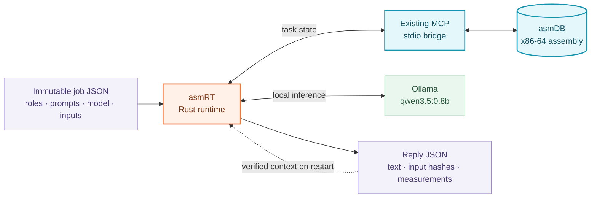

<div align="center">
  
  <h1>asmRT</h1>
  <p><strong>Agents stop. Work survives.</strong></p>
</div>

https://github.com/user-attachments/assets/a927841b-71b5-4895-8234-6aa3e1647997

asmRT is a Rust runtime for recoverable agent workflows, built on **[asmDB, the assembly database](https://github.com/fredgis/asmDB)**.

**Stateful agents, stateless LLM.** asmDB durably tracks jobs, claims and completion. Immutable JSON files preserve prompts, model settings and replies. asmRT uses that saved work to reconstruct each agent's context; the model itself keeps no memory between calls.

When a process stops, asmRT resumes unfinished work without regenerating validated, committed replies. It is a small, inspectable execution layer for agents whose work needs to outlive a process. The included demo makes that durability visible with a real local-model conversation and an actual crash.


## What actually runs

Rust uses **asmDB's existing MCP/stdio bridge** to read and update durable task state. The assembly engine stays unchanged. Full instructions and replies live in files alongside the database.

The demo calls **`qwen3.5:0.8b` through local Ollama**. One model serves four roles: Planner, Builder, Critic and Editor. Replies are generated, not scripted; no cloud API key is required. The small model can make mistakes. The demonstration is about recovering work, not proving the quality of its dinner advice.



**Small records, durable context:** asmDB stores coordination state and file references/hashes, not the full prompts or replies. Rust rebuilds the right context for each model call.

## See recovery happen

The agents plan pizza night for eight friends on $40. With the default two rounds, the controller kills Rust after four committed replies, before the next model calls, then restarts it.

Replies 1–4 survive. Workflow 1 retries one claimed turn; Workflow 2 retries a three-agent debate wave. A final replay reports `completed_now = 0` and `model_calls_now = 0`: completed work did not run again.

**Overview** keeps the story playful: large robots, the full conversation colored by agent, and visual memory. Memory tiles jump to a reply; **Latest reply** returns to the end of the conversation. A check means the native database reported completion, not merely that a reply file exists.

**Details** shows the full conversation beside asmDB, with an event dock below them. Inspect the saved instructions, attempts and replies. [See the technical console and recovery evidence](Docs/ARCHITECTURE.md#7-browser-controller-and-observable-evidence).

## Run the demo

Verified on Windows x86-64. You need Rust/Cargo with its native linker, Node.js, a built [asmDB checkout with MCP dependencies](https://github.com/fredgis/asmDB), and Ollama running locally. The example assumes sibling `repo-asmrt` and `repo-asmdb` folders.

```powershell
Set-Location "$HOME\repo-asmrt"
ollama pull qwen3.5:0.8b
& .\scripts\visualize.ps1 -AsmdbDir "$HOME\repo-asmdb"
```

Open **http://127.0.0.1:8787**, choose **Workflow 1 · Sequential** or **Workflow 2 · Discussion** using the little diagrams, then click **Start conversation**. The same button pauses and resumes. Keep the controller terminal open.

**Reset demo** stops the runtime and clears the view after confirmation. It preserves old run folders and waits for you to start a fresh run. To change the mission, reset, edit it in Details, then start. Refreshing or switching views does not restart the conversation. Pause holds future steps; an inference already running finishes at its next checkpoint.

## Workflow 1: sequential conversation

`conversation.sequential`, version `1`:

```text
Planner → Builder → Critic → Editor
          two rounds by default
```

Rust supplies each turn with **all earlier committed replies** and runs one model call at a time. It saves and commits the reply before advancing. The agents do not poll a message bus; the runtime provides their context. The browser controller only paces the demo.

## Workflow 2: discussion

`conversation.discussion`, version `1`:

```text
Planner's idea
     ├── Builder ──┐
     ├── Critic  ──┼── shared debate → Editor's decision
     └── Editor  ──┘
       two debate rounds by default
```

Builder, Critic and Editor **reply concurrently**, using the same committed history. The next round confronts their proposals and objections; a final Editor turn produces the result. Each wave waits for its required replies to be committed. A restart preserves completed branches and resumes only unfinished work.

Rust starts three model requests together; **Ollama may queue their actual token generation**. This is a bounded discussion, not an endless free-form swarm. [Read both workflow contracts](Docs/WORKFLOWS.md).

## Product direction

asmRT's core is durable coordination, not the chat interface. Next: longer-running agent jobs, additional model and tool handlers, conditional workflows and framework integrations. Each extension needs explicit rules for context, completion and recovery.

The runtime recovers known jobs in one local coordinator. A valid saved reply can be reused; inference lost before publication may run again. It does not promise exactly-once external effects, distributed orchestration or faster LLM inference. FFI and a CDC follower are not shipped.

Back up the whole run directory, including the database, instructions and reply files. The [detailed architecture](Docs/ARCHITECTURE.md) explains the persistence boundaries and limitations; [CONTEXT.md](CONTEXT.md) defines the project vocabulary.

## Contribute

Bug reports, recovery tests and focused improvements are welcome. See [CONTRIBUTING.md](CONTRIBUTING.md) for setup, tests and pull requests.

asmRT is licensed under **[MIT](LICENSE)**. asmDB, model weights and other dependencies retain their own licenses.
