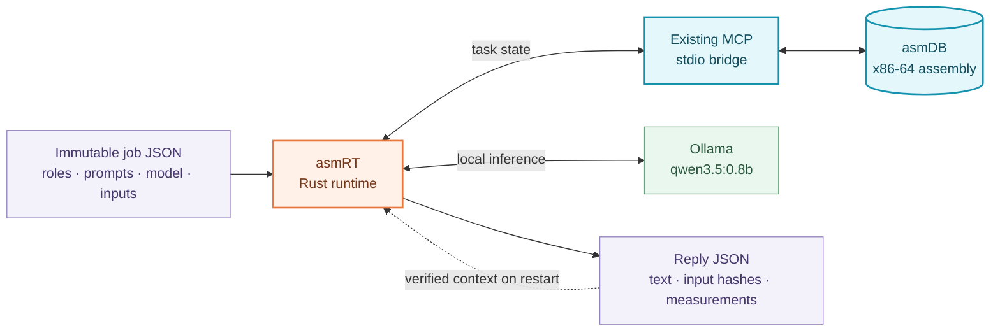
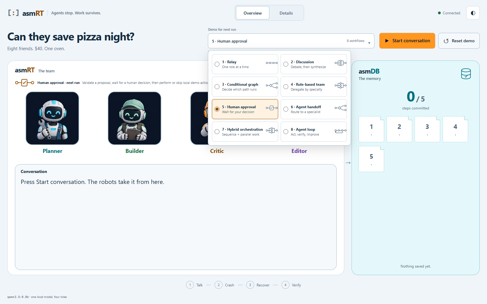
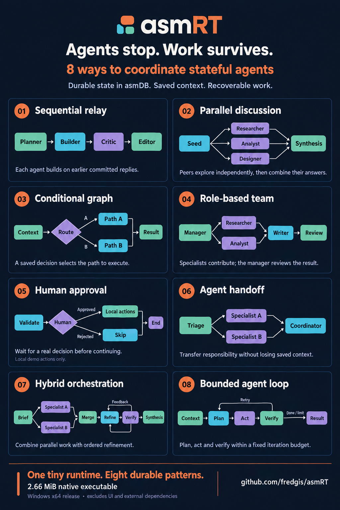
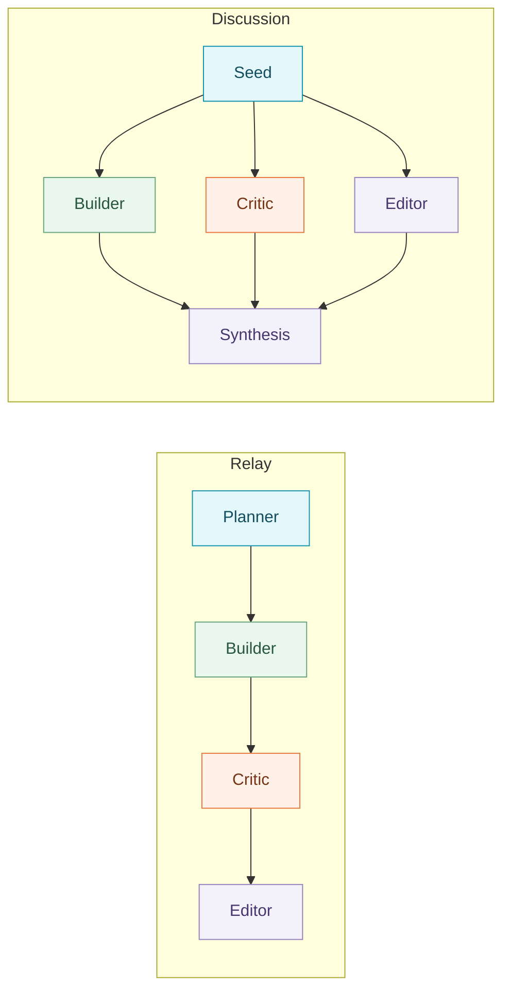
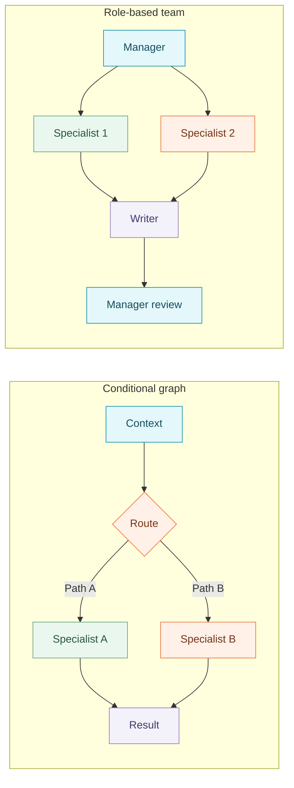
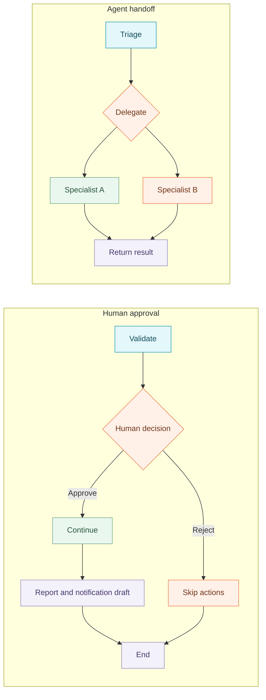
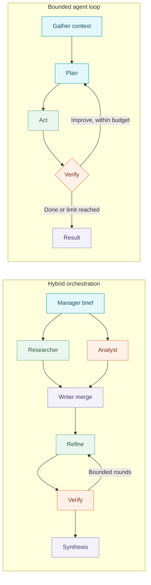
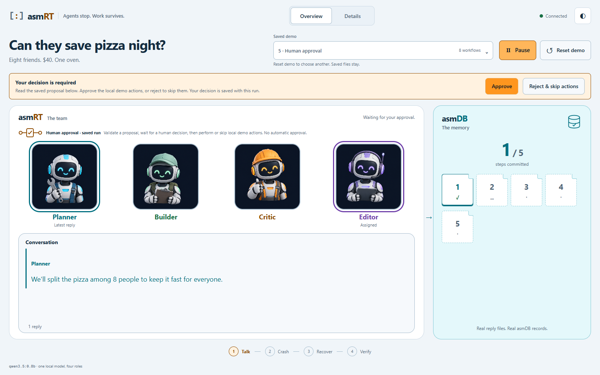

<div align="center">
  
  <h1>asmRT</h1>
  <p><strong>Agents stop. Work survives.</strong></p>
</div>

https://github.com/user-attachments/assets/a927841b-71b5-4895-8234-6aa3e1647997

asmRT is a Rust runtime for recoverable agent workflows, built on **[asmDB, the assembly database](https://github.com/fredgis/asmDB)**.

**Stateful agents, stateless LLM.** asmDB durably tracks jobs, claims and completion. Immutable JSON files preserve prompts, model settings and replies. asmRT uses that saved work to reconstruct each agent's context; the model itself keeps no memory between calls.

When a process stops, asmRT resumes unfinished work without regenerating validated, committed replies. It is a small, inspectable execution layer for agents whose work needs to outlive a process. The included demo makes that durability visible with a real local-model conversation and an actual crash.


## Tiny runtime, explicit footprint

**2.66 MiB for the native runtime executable**, including the eight workflow contracts, CLI, task coordination and local-model HTTP client.

| Measured artifact | Size |
| --- | ---: |
| `asmrt.exe` · release, Windows x86-64 GNU | **2,785,792 bytes** |
| Same executable, binary units | **2,720.5 KiB / 2.66 MiB** |

Measured on 2026-11-04 with `cargo build --locked --release`: symbols stripped, thin LTO, one code-generation unit, normal release optimization. This is **the executable's disk size, not its RAM use or the total installation**. It excludes the HTML/CSS/JavaScript demo and Node controller, asmDB and its MCP bridge, the model server and weights, runtime data, and build tools. Those components remain required for the corresponding features.

## What actually runs

Rust uses **asmDB's existing MCP/stdio bridge** to read and update durable task state. The assembly engine stays unchanged. Full instructions and replies live in files alongside the database.

The demo calls **`qwen3.5:0.8b` through local Ollama**. One model serves four roles: Planner, Builder, Critic and Editor. Model replies are generated, not scripted; human decisions, skipped paths and local tool results are separately labeled runtime artifacts. No cloud API key is required. The small model can make mistakes. The demonstration is about recovering work, not proving the quality of its dinner advice.



**Small records, durable context:** asmDB stores coordination state and file references/hashes, not the full prompts or replies. Rust rebuilds the right context for each model call.

## See recovery happen

The agents plan pizza night for eight friends on $40. Choose how they coordinate: a relay, parallel discussion, conditional routing, specialist delegation, a human gate, a handoff, a hybrid plan or a bounded feedback loop.

The controller injects a real process crash at a workflow checkpoint, then restarts Rust. Committed replies survive; unfinished claims are retried. A final replay reports `completed_now = 0` and `model_calls_now = 0`: completed work did not run again. The human-gated workflow waits for your decision instead of silently approving it.

**Overview** shows a live workflow graph beneath the asmDB memory tiles on the right. Choosing another workflow immediately previews its graph before Start, without changing the saved conversation or its memory. During a run, active nodes light up in their agent's color, including concurrent branches and the human decision gate. Labels distinguish committed, saved, skipped and last-observed steps; repeated rounds share a node. The large robots and full conversation keep their space on the left. Memory tiles jump to a reply; **Latest reply** returns to the end of the conversation. A check means the native database reported completion, not merely that a reply file exists.

**Details** shows the full conversation beside asmDB, with an event dock below them. Inspect the saved instructions, attempts and replies. [See the technical console and recovery evidence](Docs/ARCHITECTURE.md#7-browser-controller-and-observable-evidence).

## Run the demo

Verified on Windows x86-64. You need Rust/Cargo with its native linker, Node.js, a built [asmDB checkout with MCP dependencies](https://github.com/fredgis/asmDB), and Ollama running locally. The example assumes sibling `repo-asmrt` and `repo-asmdb` folders.

```powershell
Set-Location "$HOME\repo-asmrt"
ollama pull qwen3.5:0.8b
& .\scripts\visualize.ps1 -AsmdbDir "$HOME\repo-asmdb"
```

Open **http://127.0.0.1:8787**, open the **8 workflows** picker, choose a diagrammed workflow, then click **Start conversation**. The same button pauses and resumes. For **Human approval**, read the proposal and explicitly approve or reject it. Keep the controller terminal open.



**Reset demo** stops the runtime and clears the view after confirmation. It preserves old run folders and waits for you to start a fresh run. To change the mission, reset, edit it in Details, then start. Refreshing or switching views does not restart the conversation. Pause holds future steps; an inference already running finishes at its next checkpoint.

## Eight ways to coordinate

All eight use the same runtime, asmDB state and immutable context. These are executable, bounded workflow contracts, not just diagram presets. The four colored identities remain recognizable; their saved instructions define the specialist work.

[](Docs/assets/asmrt-workflows-poster.png)

| # | Workflow | What happens | Useful for |
| --- | --- | --- | --- |
| 1 | **Relay** | Planner → Builder → Critic → Editor, one turn at a time. Each reads all earlier committed replies. | Ordered drafting and review. |
| 2 | **Discussion** | A seed opens parallel debate waves; a final synthesis reconciles the saved replies. | Comparing proposals and objections. |
| 3 | **Conditional graph** | A committed decision selects a path before the result is finalized. | Different handling for different cases. |
| 4 | **Role-based team** | A manager briefs parallel specialists, a writer synthesizes, then the manager reviews. | Dividing a goal by expertise. |
| 5 | **Human approval** | Validate, wait for a person, then perform or skip local actions according to the saved decision. | Keeping a human in control. |
| 6 | **Agent handoff** | Triage routes context to a specialist, whose answer returns to the coordinator. | Passing responsibility without losing context. |
| 7 | **Hybrid orchestration** | Parallel specialists feed a merge, bounded refinement/verification rounds and final synthesis. | Mixing dependencies and independent tasks. |
| 8 | **Agent loop** | Gather context, plan, act and verify within a fixed iteration budget. | Revising a result with feedback. |

Parallel requests can still be queued by the model server. None of these patterns promises faster inference or exactly-once external effects. [Exact contracts, decision rules and recovery boundaries →](Docs/WORKFLOWS.md)

<details>
<summary><strong>Explore the workflow diagrams</strong></summary>

### Relay & discussion



### Conditional graph & role-based team



### Human approval & agent handoff



### Hybrid orchestration & agent loop



These diagrams show control flow. Branches converge after the selected path; they do not imply both alternatives perform model work. Run-specific jobs and dependency IDs remain inspectable in Details.

</details>



## Product direction

asmRT's core is durable coordination, not the chat interface. Next: longer-running agent jobs, additional model and tool handlers, user-defined graphs and integrations. Each extension needs explicit rules for context, completion and recovery.

The runtime recovers known jobs in one local coordinator. A valid saved reply can be reused; inference lost before publication may run again. It does not promise exactly-once external effects, distributed orchestration or faster LLM inference. FFI and a CDC follower are not shipped.

Back up the whole run directory, including the database, instructions and reply files. The [detailed architecture](Docs/ARCHITECTURE.md) explains the persistence boundaries and limitations; [CONTEXT.md](CONTEXT.md) defines the project vocabulary.

## Contribute

Bug reports, recovery tests and focused improvements are welcome. See [CONTRIBUTING.md](CONTRIBUTING.md) for setup, tests and pull requests.

asmRT is licensed under **[MIT](LICENSE)**. asmDB, model weights and other dependencies retain their own licenses.

## Adapting the demo to your own context

Pizza night is a sample mission, not a requirement of the runtime. You can reuse the implemented workflow patterns for other topics, such as support, analysis or drafting. Changing the mission does not change the workflow's structure.

| What you want to change | Current support |
| --- | --- |
| **The mission** | Already configurable: enter another topic before Start. |
| **Agent names and instructions** | Saved in the plan, but currently initialized by `agents()` in [src/chat.rs](src/chat.rs). Changing these defaults affects new runs; a user-facing editor requires a configuration extension, not a new persistence engine. Internal agent IDs and the four-role structure remain fixed. |
| **The local LLM** | Set `ASMRT_OLLAMA_MODEL` before launching the console, or use `chat --model <installed-model>` in the CLI. All four agents currently share one model configuration. |
| **A remote LLM provider or a different model per agent** | Requires code changes; neither is currently supported. |
| **Steps, dependencies and routing rules** | The eight workflow structures are implemented in code. Arbitrary user-defined graphs are not yet configurable. |

These patterns are reusable, but they are not yet a general-purpose no-code workflow builder. Real business actions also need integrations: the approval demo creates or skips local artifacts; it does not charge a payment or send a notification.

**Start a new conversation when changing settings.** A saved run keeps its original topic, agent instructions, model identity and job definitions so recovery can validate and reuse completed work. Do not edit an existing run's saved files to repurpose it.
