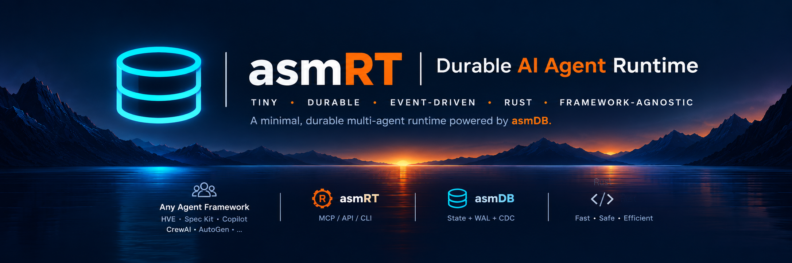
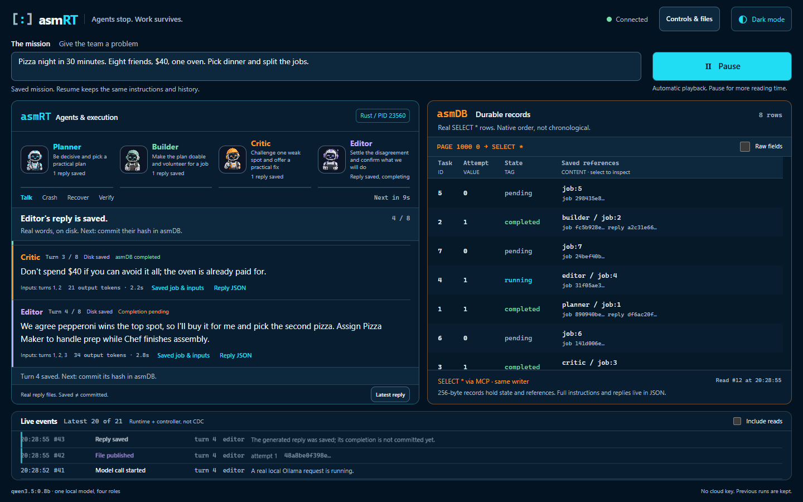

<div align="center">
  
  <h1>asmRT</h1>
  <p><strong>Agents stop. Work survives.</strong></p>
</div>

A **Rust runtime prototype over [asmDB](https://github.com/fredgis/asmDB)**. Four agents have a real local-model conversation. Kill Rust halfway through; restart it; they continue from saved instructions and replies.

**Local POC · Windows x86-64 verified · asmDB unchanged · no cloud key**



## Run it

You need **Rust/Cargo and its native linker**, **Node.js**, a built **asmDB** checkout with its MCP dependencies installed, and **Ollama running locally**. Follow [asmDB's setup](https://github.com/fredgis/asmDB) for the sibling checkout.

```powershell
Set-Location "$HOME\repo-asmrt"
ollama pull qwen3.5:0.8b
& .\scripts\visualize.ps1 -AsmdbDir "$HOME\repo-asmdb"
# Open http://127.0.0.1:8787
```

Click **Start conversation** once. Everything advances automatically; the same button pauses and resumes. Keep the controller terminal open.

One `qwen3.5:0.8b` model (about **1.3 GB** for the tested Ollama package) serves **Planner, Builder, Critic and Editor** sequentially. These are four roles, not four copies of the model. Replies are genuine, not scripted; the small model can still make mistakes.

## The demo: save pizza night

1. **Talk:** eight friends, $40, one oven. Four agents agree on dinner and split the jobs.
2. **Complication:** the oven breaks. That update is already in the saved second-round instructions.
3. **Crash:** turn 5 is claimed, then the controller kills the **actual Rust process**, before its model call.
4. **Recover:** a new process verifies replies 1–4 and retries only turn 5 at attempt 2. The conversation continues.
5. **Verify:** one final restart reports **`completed_now = 0`** and **`model_calls_now = 0`**.

The prompts request short replies. Each saved reply stays on screen for at least 6.5 seconds; inference time varies. Custom topics work too, without the pizza-specific twist.


### Reading the console

- **asmRT, left:** the four illustrated agents and their actual saved replies.
- **asmDB, right:** real `db_list` results through the existing writer connection. **Raw fields** shows exact bridge-decoded values.
- **Live events, below:** runtime/controller observations, always visible on desktop. This is **not CDC**.
- **Select a record or reply:** inspect its saved job and JSON. **Controls & files** contains manual controls and the no-LLM storage demo.

Conversation and records scroll independently. On narrow screens the panes stack. Refreshing the browser does not restart the run. Pausing holds future steps; it does not cancel an inference request already running.

## How does it know what to resume?

**Not from status alone.** Each turn has a versioned job containing its instructions, agent role, model settings and previous-reply IDs. Rust reloads that job and calls its known handler.

| Native field | Meaning |
| --- | --- |
| `ID` | Task / conversation turn |
| `VALUE` | Attempt: 0 before claim, 1 on first claim, 2 after retry |
| `TAG` | `asmrt.v2.pending`, `.running` or `.completed` |
| `CONTENT` | Compact references: `o` owner, `d` job, `h` job SHA-256, `r` reply-file SHA-256 |

Each native record is **256 bytes**. Full instructions and replies live in external JSON, not in its 175-byte content field.

```text
.asmrt\visual\<run-id>\
  conversation.json       topic, roles, model and turn plan
  definitions\<id>.json   executable job and input references
  artifacts\<id>.json     real reply, input hashes and request provenance
  asmrt.dat / .wal / .cdc native coordination state
```

**Keep the whole run directory.** New runs preserve previous folders. Saved settings are immutable; start a new run to change the mission or model.


## Architecture and guarantees

```text
Rust handlers → State Actor → existing MCP/stdio bridge → unchanged asmDB
      │
      ├─ local Ollama inference
      └─ durable job and reply files
```

One State Actor serializes task transitions through **one writer per database**. Jobs are saved before their references; replies are saved before completion. Reopening requeues interrupted assignments, validates saved work and leaves completed turns intact.

- Recovery restores **known jobs**, not process memory or arbitrary code.
- A matching saved-but-uncommitted reply can be reused. Inference lost **before publication** may run again.
- This is **not exactly-once external effects**, a power-loss certification or a performance benchmark.
- No FFI integration, distributed leases, CDC follower, cloud adapter or autonomous tool execution is shipped.

**[Detailed architecture →](Docs/ARCHITECTURE.md)** — process boundaries, record codec, APIs, crash points, persistence guarantees, operations, tests and roadmap. Older concept artwork is retained there and explicitly separated from implemented features.

## Tests

```powershell
$env:ASMRT_ASMDB_REPO = "$HOME\repo-asmdb"
& .\scripts\cargo.ps1 test --locked --quiet
& .\scripts\cargo.ps1 test --locked --quiet '--' --ignored --test-threads=1
node --test .\visualizer\test\*.test.mjs
```

The Node integration tests use real Rust and asmDB with a **test-only** local model fixture. The application has no canned-response fallback. The screenshots above were captured from the running demo with real Ollama replies.
