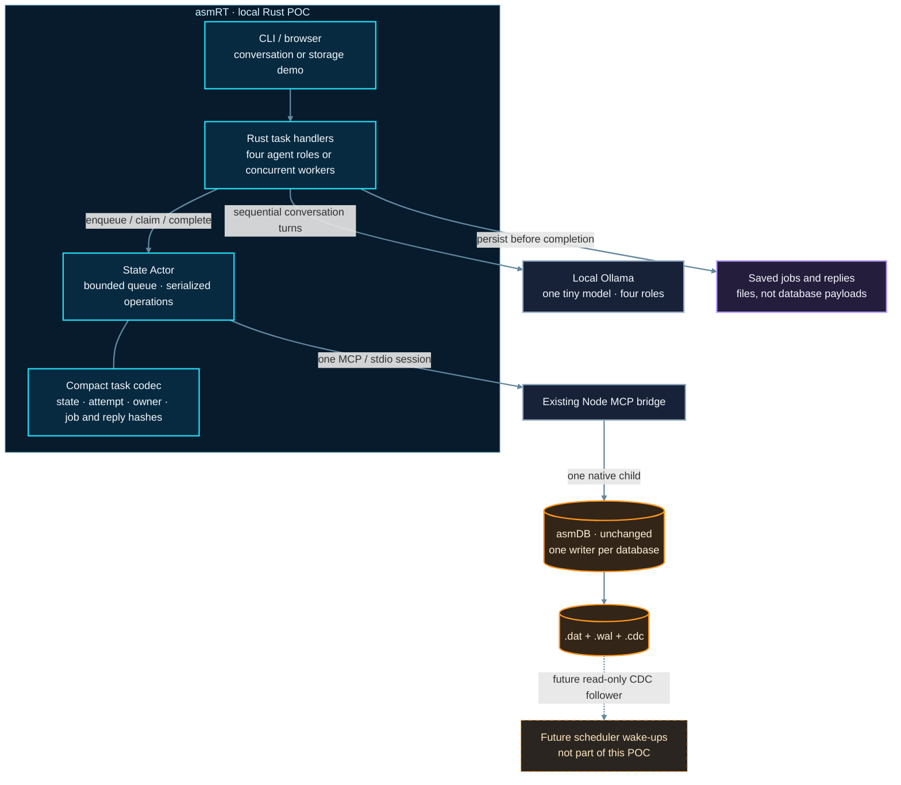
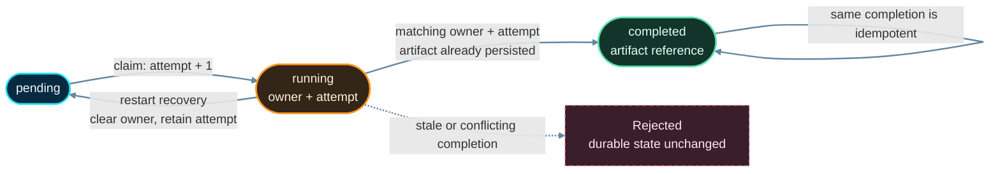
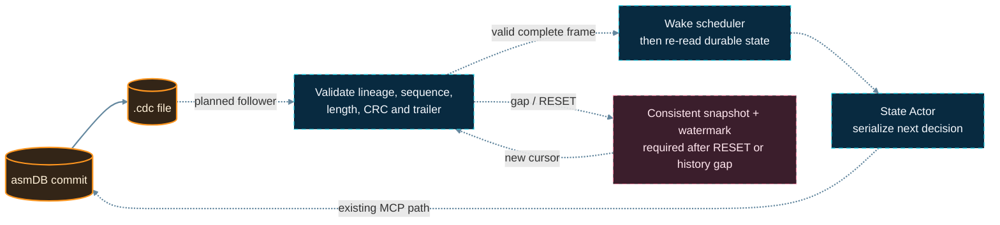

<div align="center">
  

  <h1>asmRT</h1>
  <p><strong>Rust orchestration. Durable coordination state in asmDB.</strong></p>
  <p>Local-first by design · Concurrent agents · One writer per database · No changes to asmDB</p>
</div>

> **Status: local POC v0.1.0, tested on Windows x86-64.** Four agents now converse through a real local Ollama model, using versioned job definitions, saved message dependencies and asmDB-backed crash recovery. The original concurrent storage demo remains available. Leases, CDC consumption, framework adapters, general-purpose tools and cloud integration are not implemented. The banner describes the longer-term direction, not shipped integrations or measured performance.

## The project

**asmRT** is a Rust runtime prototype for durable AI-agent coordination, built around the existing [asmDB](https://github.com/fredgis/asmDB) engine. Its main demonstration is a real conversation between **Planner, Builder, Critic and Editor**. A separate deterministic demo tests concurrent coordination without an LLM.

Agents can work concurrently. Their shared operational state passes through **one State Actor**, which owns **one MCP session** backed by **one asmDB writer per database**. Rust runs the work; asmDB remembers its state.

The goal is not to make arbitrary Rust code faster, build another vector database, or put an LLM's entire memory in a tiny record. It is to make small, meaningful coordination decisions persistent: **what is ready, who owns it, which attempt is running, what completed, and where its output lives**.

asmDB remains a standalone assembly engine. This integration does not fork, link, rewrite or modify it, or change its storage format.

## Start the four-agent conversation

Use the existing asmDB checkout and MCP dependencies, Node.js, Rust/Cargo, and **Ollama running locally**. No cloud account or API key is needed.

```powershell
Set-Location "$HOME\repo-asmrt"
ollama pull qwen3.5:0.8b
& .\scripts\visualize.ps1 -AsmdbDir "$HOME\repo-asmdb"
# Open http://127.0.0.1:8787
```

Choose **Agent conversation**, enter a topic, and click **Start conversation** once. The four illustrated agents now show genuine model responses, not a scripted exchange. One installed **`qwen3.5:0.8b`** model (about **1.3 GB** on disk for the tested Ollama package) serves four logical agents with distinct saved instructions. They take turns **sequentially**, not as four model copies running in parallel. Each request includes the exact preceding saved messages. The initial `qwen3:0.6b` experiment was too repetitive; it remains usable for earlier saved runs. The newer model is still tiny: its replies can repeat or be wrong, and demonstrate conversation persistence rather than reliable expert reasoning.

The English presentation advances automatically, holding each saved reply for 6–18 seconds according to its length; Pause lets you read longer. Actual inference latency varies, so this is not the old fixed-length storage animation:

1. Persist a topic, four roles and eight turn definitions; show their native asmDB records.
2. Planner proposes an idea; Builder develops it; Critic challenges it; Editor connects their actual contributions.
3. After those four messages are committed, assign turn 5 and **kill the real Rust process before its model request**.
4. Reopen the same run. Validate the saved instructions and messages; retry turn 5 at attempt 2 using messages 1–4, then finish the second round.
5. Reopen once more: **`completed_now: 0`, `model_calls_now: 0`**. Completed replay does not need Ollama to be reachable.

Pause/resume controls the server-owned timer. A model request already in progress can finish and save its reply, then waits at the next checkpoint; pausing is not cancelling inference. Refreshing the browser does not restart the discussion. Opening the definition or reply inspector reads the actual files and checks their hashes. The database pane remains a real `SELECT *` observation through the one existing MCP connection.

### What makes conversation recovery possible

**Statuses alone are not sufficient.** Each run keeps these files together:

| Saved data | Purpose |
| --- | --- |
| `conversation.json` | Immutable topic, role prompts, model identity/settings and ordered turn plan |
| `definitions\<id>.json` | Versioned `llm.chat.turn` job: agent, full instructions, topic, model settings and prior message IDs |
| `artifacts\<id>.json` | Actual reply, agent/model identity, input-file hashes, job/request hashes and generation measurements |
| `asmrt.dat`, `.wal`, `.cdc` | Native task state, owner, attempt, job reference/hash and committed reply-file hash |

The new **`asmrt.v2.*`** records retain the native schema: `id` = turn, `value` = attempt, `tag` = state; compact `content.d` points to `job:<id>`, `h` hashes its definition, `o` identifies the current agent, and completed `r` hashes the entire reply file. Full prompts and messages stay outside the 175-byte record payload. Back up the **whole run directory**, not just the database.

Rust still implements a known handler: the current `llm.chat.turn` version 3 builds a role-aware request—an agent's own earlier replies use the assistant role, and named teammates' replies use the user role. Versions 1 and 2 retain their original request encoding to preserve earlier saved hashes. The JSON job envelope is `asmrt.task.v1`; this handler version is separate from native record codec v2. Recovery reloads job data and calls the saved handler version. It does **not** restore arbitrary code, process memory or an instruction pointer.

A missing/changed job, missing committed input, changed committed reply, unsupported handler or changed installed model digest stops execution instead of guessing. The model tag's digest is checked before new requests; do not replace that local model while a run is active. A matching reply published before a crash but not yet committed is reused without another model call. However, **a crash after inference starts but before its reply is saved can cause another inference request**. This is not exactly-once model execution or exactly-once external effects. These agents have no tool or code-execution permissions.

### CLI and local-model settings

```powershell
$env:ASMRT_ASMDB_REPO = "$HOME\repo-asmdb"
& .\scripts\cargo.ps1 run --locked --quiet '--' --data-dir .asmrt\conversation chat `
  --topic "Plan a free neighborhood book swap with one table, two volunteers and a rain backup." --events

# Resume the SAME conversation, or verify zero new calls after completion
& .\scripts\cargo.ps1 run --locked --quiet '--' --data-dir .asmrt\conversation chat --events
```

The CLI has no automatically scheduled crash; that teaching sequence belongs to the browser controller. Use a dedicated directory: the legacy CLI default `.asmrt\demo` is for the deterministic demo. Saved settings are immutable; use a **new run/directory** for a different topic, model or number of rounds.

New runs default to a simple neighborhood book-swap discussion, two rounds, eight turns, `qwen3.5:0.8b`, and `http://127.0.0.1:11434`. CLI options `--model`, `--ollama-url`, `--rounds` (1–3) or environment variables `ASMRT_OLLAMA_MODEL` / `ASMRT_OLLAMA_URL` configure the local model. The controller also accepts `--conversation-model` and `--ollama-url`. Only local loopback HTTP endpoints are allowed, with no redirects, credentials or proxy. Custom models must already be installed; the application never silently downloads a larger model or substitutes canned replies.

`POST /api/conversation {"topic":"..."}` starts a fresh automatic conversation when no runtime is active; it cannot silently stop existing work. Topics are limited to 400 characters. `POST /api/play {}` resumes its timer and `POST /api/pause {}` pauses it. `/api/state` includes the actual messages, publication/commit status and current inference stage. `GET /api/definitions/<id>` returns a hash-checked descriptor; `GET /api/artifacts/<id>` returns the actual reply JSON. All command routes use the same origin/token checks as the storage demo.

## Deterministic storage demo (no LLM)

Prerequisites: a built asmDB checkout (`build\asmdb.exe` on Windows), its installed [Node MCP dependencies](https://github.com/fredgis/asmDB/tree/main/mcp), Node.js, and Rust/Cargo. This machine has an isolated GNU Rust toolchain under ignored `.tools`; `scripts\cargo.ps1` uses it when present, otherwise the installed Cargo. A fresh checkout needs its own Rust toolchain and linker prerequisites.

```powershell
Set-Location "$HOME\repo-asmrt"
$env:ASMRT_ASMDB_REPO = "$HOME\repo-asmdb"

# 100 tasks, four workers, no model calls
& .\scripts\cargo.ps1 run --locked --quiet '--' demo --tasks 100 --workers 4

# Reopen persisted state; this also recovers interrupted running tasks
& .\scripts\cargo.ps1 run --locked --quiet '--' status

# Repeat the demo: completed_now becomes 0, not 100
& .\scripts\cargo.ps1 run --locked --quiet '--' demo --tasks 100 --workers 4
```

Quote `'--'` when forwarding Cargo arguments through PowerShell. Default state is in **`.asmrt\demo`**, not the asmDB checkout. Use `--data-dir <new-directory>` **before** `demo` or `status` to isolate another run. A nonempty directory without the asmRT ownership marker is refused.

A successful first run ends with a JSON summary containing `total: 100`, `completed: 100`, `completed_now: 100`, `pending: 0`, `running: 0` and `max_attempt: 1`. Progress and summaries are JSON lines on stdout; diagnostics go to stderr. `artifact:<id>` resolves to `artifacts\<id>.json` inside that demo directory. Files are flushed and published without replacing an existing file before their references are committed. An identical orphan artifact is reused; conflicting content stops the run and is left untouched.

**Restart:** rerun the same command and directory. Interrupted `running` tasks become `pending`, retaining their old attempt; the next claim increments it. Completed tasks are not reset. This is restart recovery, not automatic lease expiry or live worker replacement. `status` is an exclusive writer-backed open with recovery, **not** a concurrent read-only monitor.

### Watch a real run in the browser

```powershell
# Builds the Rust CLI and starts the local viewer; no npm install needed
& .\scripts\visualize.ps1 -AsmdbDir "$HOME\repo-asmdb"
# Open http://127.0.0.1:8787
```

Choose **Storage demo** instead of Conversation and start its story. This separate **English, automatically timed story** takes about **75 seconds**, with four illustrated Rust workers, eight real result files, and a live asmDB record console. No manual stepping is needed:

1. Eight pending records enter asmDB. Four workers claim tasks; the listing shows their owners and attempts.
2. Four JSON files appear. Their records still say `running` until completion and artifact references are committed.
3. The remaining four tasks are assigned, then the controller **kills the actual Rust process**. The workers stop; the last database observation and existing files remain visible.
4. A new Rust process reopens asmDB. Four completed tasks stay completed; only the four unfinished tasks are retried, at attempt 2.
5. All eight results finish. A final automatic restart checks the existing files and ends on **zero new tasks executed**.

**Pause** freezes the server-owned story timer, not just an animation. An operation already in progress can finish at its next real checkpoint, then waits. **Resume** keeps the remaining time. Refreshing the page does not reset or skip a scene. The server continues the story if the page is closed or disconnected; pause before leaving if you want it to wait. A controller restart cancels its timers and waits for Play/Resume before reopening the saved database.

The console displays **actual `db_list` responses** read through the State Actor's existing MCP connection. The unchanged bridge executes `PAGE 1000 0` and `SELECT *`, parses native TSV, and returns the displayed records; this is not fabricated terminal output or a byte-for-byte stdout transcript. `value` is the attempt, `tag` is the state, `content.o` is the worker, and `content.r` is the artifact reference. A retained listing after interruption is explicitly a last observation until a new database read arrives.

Click a published file to inspect its actual JSON. The technical disclosure retains the event journal, source paths and independent unpaced/manual controls. The illustrations represent **deterministic Rust workers, not LLM agents**. Scene holds and the small work delay are teaching aids, **not database latency measurements**. An unobserved publication after recovery does not prove a file is absent. The viewer never opens a second MCP writer, consumes CDC, or provides a continuous backend health check.

Run directories are retained under **`.asmrt\visual\<run-id>`**; the existing `.asmrt\demo` is untouched. Starting another run preserves the previous one. The latest configuration survives a viewer restart, but the task listing is not invented from it: resume to reread asmDB. The observation journal is in memory (last 160 events), not a durable CDC log. Use one viewer per data root; `-DataRoot <dedicated-directory>` and `-Port <port>` select a separate instance.

The server binds only to `127.0.0.1`, accepts mutations only from its own origin with a per-launch token, and serves no arbitrary filesystem paths. It is a local teaching tool, not a remotely authenticated service. Keep its terminal open; Ctrl+C shuts down the server and its owned demo. Close the browser without stopping the server to reconnect later. `-SkipBuild` reuses an already-built CLI.

For another observer, `demo --events` adds an initial recovered task snapshot and `task_claimed`, `artifact_published`, and `task_completed` JSON lines. Each event follows the corresponding acknowledgement or successful file publication; normal CLI output is unchanged without the flag.

`demo --events --guided` adds a fresh `database_read` event before every numbered `checkpoint` (`ready`, `claimed`, `published`, and, between batches, `completed`), plus a final database read. Each read is the first page of up to 1,000 records, with the bridge's pagination metadata. Send exactly `next <sequence>` followed by a newline on stdin to advance; EOF or a mismatched command stops the run. Completed replay rereads records and needs no input. Guided mode cannot be combined with diagnostic `--pause`.

The browser's automatic director owns these gates: `POST /api/storage {}` starts a fresh storage story; `POST /api/play {}` resumes the current story; `POST /api/pause {}` freezes its timer. `/api/state` includes `playback` (scene, status and remaining milliseconds) and `database` (last real query response). Timer callbacks are bound to their run, launch and checkpoint and are cancelled on pause, replacement or shutdown. The next writer is never started before the previous child closes. Automatic playback stops on an error rather than retrying an uncertain operation.

Manual HTTP clients can still post `{"checkpoint":"<id>"}` to `/api/next`, using the current `checkpoint.id` and the same origin/token protections. Pause automatic playback before manual stepping. The checkpoint ID includes a fresh launch identity, so stale or duplicate continuations cannot release a different checkpoint. The journal sequence is unrelated to the CLI checkpoint sequence.

### Tests and deliberate interruptions

```powershell
& .\scripts\cargo.ps1 test --locked --quiet
& .\scripts\cargo.ps1 test --locked --quiet '--' --ignored --test-threads=1
& .\scripts\test-recovery.ps1 -AsmdbDir $env:ASMRT_ASMDB_REPO
node --test .\visualizer\test\server.test.mjs .\visualizer\test\conversation.test.mjs
```

The first command runs the four codec tests. The second runs eight real-engine runtime tests and four CLI tests, sequentially, using temporary databases. The second-writer test intentionally produces a Node startup error on stderr; its final test result must still pass. The PowerShell 7+ fault harness is Windows-specific: it kills only recorded process IDs belonging to its own test runs, verifies child exit and lock release, and removes its disposable data.

Verified scenarios include full-width integer persistence, 16 contending claims, idempotent completion, stale attempts with a reused owner name, startup pagination across 1,001 tasks, unrelated-data protection, second-writer exclusion, 100-task execution/replay, conflicting artifacts, lifecycle event ordering and separate loss of Rust, Node and asmDB. Rust is also killed **after artifact publication but before completion**, verifying replay without replacing the artifact. The guided CLI test verifies actual waiting even with zero work delay, fresh database listings, a partial final batch, and replay without stdin. The nine Node HTTP tests additionally cover real observations and artifact reads, interruption/recovery, viewer restart/replay, rejected foreign or malformed commands, the guided sequence, the entire one-click story, early restart with accurate captions and reused uncommitted files, pause during work, retained countdowns, and cancellation of old timers when restarting the controller or replacing a run. They require `ASMRT_ASMDB_REPO` and a built CLI, and otherwise skip the real-engine scenarios.

The nine additional conversation tests use real Rust/asmDB and an explicitly **test-only local HTTP model fixture**. They verify causal inputs, a real midpoint crash, unchanged committed replies, offline zero-call replay, orphan-reply reuse after controller restart, pause during inference, missing/modified definitions and plans, unsupported handlers, changed model digests, topic validation, and authorization. Fixture messages never appear in the application; the delivered demonstration uses actual Ollama inference. Rust tests also verify that typed definitions survive recovery and cannot be rebound or forged by a stale claim.

For an interactive diagnostic boundary:

```powershell
& .\scripts\cargo.ps1 run --locked --quiet '--' --data-dir .asmrt\interrupt demo --tasks 100 --workers 1 --pause artifact
```

The CLI pauses once after the first published artifact. Press Enter to resume, or terminate the Rust process and rerun without `--pause`. `--pause claim` instead stops immediately after the durable claim. These process-loss tests do not certify power-loss/device-failure behavior or exactly-once external effects. No end-to-end performance claim is made.

## Project summary



[Editable Mermaid source](docs/diagrams/architecture.mmd). Cyan: Rust; gray: existing bridge and local model; orange: storage; purple: external payloads. Dashed paths are future work. The earlier [poster](docs/assets/asmrt-summary.png) remains a design reference, not the current implementation diagram.

## What goes into asmDB — and what does not

| In asmDB: compact coordination state | Outside asmDB: payloads |
| --- | --- |
| Task, run and agent identifiers | Prompts and full conversation history |
| Status, owner and attempt/generation | Documents, source files and patches |
| Retry counters, deadlines and lease metadata | Full tool outputs, logs and large LLM results |
| Approval state and compact checkpoint markers | Full execution snapshots and framework checkpoints |
| Short artifact identifiers, hashes or references | Embeddings, vector indexes and model weights |

External payloads live in files or object storage. asmDB holds references, not the content behind them. Credentials belong in the host's credential mechanism, not in coordination records.

The table above includes future coordination metadata. The **legacy v1 task codec** stores task ID, state, attempt, owner and an optional artifact reference. Conversations use **v2**, adding an immutable job reference and SHA-256 while retaining the same native schema. A completed legacy record is:

```json
{
  "id": "1001",
  "tag": "asmrt.v1.completed",
  "value": "2",
  "content": "{\"o\":\"worker-1\",\"r\":\"artifact:1001\"}"
}
```

Tags are `asmrt.v1.pending`, `asmrt.v1.running` and `asmrt.v1.completed`. `value` is the nonnegative attempt counter, bounded by `i64::MAX`. Pending content is `{}`; running content contains `o`; completed content also contains `r`. Owners must occupy **1–32 UTF-8 bytes**. The entire serialized content, including JSON escaping, must fit 175 bytes. Unknown schemas and inconsistent ownership/state are rejected, not silently rewritten.

### Design within the existing record limits

- A record is **256 bytes**, with a fixed schema.
- `tag` holds **39 usable UTF-8 bytes** and must be a token without whitespace.
- `content` holds **175 usable UTF-8 bytes**, not 175 characters. The MCP bridge also rejects NUL, tabs and line breaks.
- `id` is a non-zero `u64`; `value` is an `i64`. Use decimal strings over MCP to preserve integer precision.
- Prefer explicit numeric IDs for the initial codec. MCP string `key` addressing consumes part of the content budget for hidden key metadata.
- A database is one table. Transactions do not span databases. Native transactions are limited to **4,096 distinct rows**.
- ID lookup is hash-indexed; `FIND`, `RANGE` and listing scan the configured slot table. A scheduler should not assume a secondary index on status.

A compact engine binary does **not** imply a tiny total deployment. The bridge requires Node.js. This POC explicitly requests asmDB's **small** capacity: 524,288 slots, approximately **128 MiB logical data** plus the header, sparse where supported. The verified Windows demo's `.dat` is 134,218,240 logical bytes: 128 MiB plus a 512-byte header. The runtime admits at most **10,000 tasks** into its startup index; `Config::max_tasks` can lower that limit. Capacity is fixed at database creation. This is not a throughput or memory-use benchmark.

## Local architecture

The initial integration uses the **existing Node MCP bridge**, not a hypothetical native Rust library:

The [colored Mermaid overview](#project-summary) is the primary architecture diagram. Its solid path is the first local slice; the CDC follower and event-driven scheduler are separate future work.

Earlier concept visuals are retained for reference: [SVG](docs/architecture/asmrt.svg), [JSON source](docs/architecture/asmrt.architecture.json), and [interactive HTML](docs/architecture/asmrt.html).

### Ownership is the central invariant

1. The State Actor serializes **whole logical operations**, not just individual lines or writes. Reads participating in a claim/update decision use the same queue.
2. Workers request operations such as claiming or completing a task. They do not open their own writer or access storage files directly.
3. There is one authoritative coordinator for a database in the local POC. Another asmDB writer is rejected by the engine's file locking: `LockFileEx` on Windows, advisory `flock` on Linux. This is cooperative process exclusion, not a security boundary against arbitrary file writes.
4. Native `--reader` processes exist in asmDB, but the current local MCP bridge launches a writer. A reader pool is not part of the initial design.
5. asmRT must own the child-process lifecycle: startup, readiness, timeouts, cancellation and shutdown. A timed-out mutation can have committed; reconcile before retrying rather than treating a missing response as a rollback.

**Serialization is not the same as a transaction.** The current MCP tool set exposes CRUD operations, but no public arbitrary `BEGIN` / `COMMIT` group spanning multiple tool calls. Its upsert uses an internal transaction. The first POC therefore targets **single-record durable transitions under the sole State Actor**. Multi-row atomic operations would require a separately designed transport capability, without changing asmDB; this README does not pretend that capability already exists.

The native engine targets x86-64 Windows and Linux. This POC was validated on Windows; the Linux adapter path is present but unverified here. Rust's wider platform support does not make this integration ARM-, macOS- or WebAssembly-native.

### Rust API and failure behavior

The library exports `Config`, `Runtime`, `StateHandle`, `Task`, `TaskState`, `DefinitionRef`, `Record` and `Error`.

| Operation | Contract |
| --- | --- |
| `Runtime::open(config)` | Validate a dedicated directory, initialize the owned bridge, scan and validate all tasks, then requeue interrupted work; application file validation follows this open |
| `state.enqueue(id)` | Persist a legacy pending task; an existing legacy ID returns its state without resetting it; cannot adopt a typed job |
| `state.enqueue_defined(id, definition)` | Bind a task to an immutable `DefinitionRef`; an existing ID must have exactly the same definition |
| `state.claim_next(owner)` | Claim the lowest-ID pending task, incrementing its attempt; `None` means none is pending |
| `state.complete(&claim, reference)` | Require matching definition, owner and attempt; identical completion is idempotent, conflicting completion is rejected |
| `state.get(id)` / `state.list()` | Read the actor's acknowledged in-memory index through the same bounded queue |
| `runtime.shutdown()` | Close the queue, finish an in-flight operation, close the bridge/native child and await exit |

The mailbox holds 64 requests. The cache changes only after a matching backend acknowledgement. Reads are not a backend heartbeat. Once queued, an operation can commit even if its caller drops the response future. Transport or backend failures close the actor: **reopen and reconcile before retrying**, especially after a timeout. Invalid inputs and task conflicts do not poison the actor.

Call `shutdown().await` explicitly; dropping the runtime requests best-effort shutdown while the Tokio executor is alive. The actor does not retry uncertain writes, create a distributed claim protocol, or promise exactly-once tools. The library's completion API accepts a reference; **the application must persist and validate the external result first**. The supplied CLI performs that file step.

## Task lifecycle in the first slice



[Editable Mermaid source](docs/diagrams/task-lifecycle.mmd). Recovery is tied to coordinator restart, not a shipped lease/TTL service. General external effects remain at-least-once unless the tool itself provides idempotency.

## CDC: a change log, not a ready-made broker

asmDB already writes a `.cdc` file. **asmRT's Rust CDC follower still needs to be built.** The existing MCP bridge does not stream CDC notifications.

The intended loop is:



[Editable Mermaid source](docs/diagrams/cdc-roadmap.mmd). This loop is a roadmap, not a shipped follower.

The follower must follow the engine's existing contract:

- Validate the log identity, supported format, frame length, checksum, trailer and dense commit sequence.
- Wait on an incomplete trailing frame. Stop on a complete but corrupt frame; do not silently skip it.
- Track a durable consumer position using the database lineage and commit sequence, not only a byte offset. Advance it only after the relevant work has been durably accounted for.
- Handle log replacement, retention and `RESET` explicitly. Missing required history means a consistent re-snapshot, not silently continuing from the tail. A snapshot after `RESET(N)` must have a watermark of at least `N`.
- Treat CDC notifications as wake-up hints. A frame can be visible before the data-file update finishes; decisions still go through the State Actor and recovered engine state.
- Reconcile durable tasks on startup and after interruptions. A wake-up lost from an in-memory queue must not strand work forever.

The follower never writes, trims or repairs asmDB's files. Its transport, acknowledgements and scheduling behavior are asmRT responsibilities. Exact CDC-backed snapshots are a later milestone: the current CRUD-only MCP tool set does not expose `BACKUP` either.

**WAL durability does not make external effects exactly-once.** A worker may finish a tool call and crash before recording success. Recovery needs attempt/generation checks, idempotency keys where supported, and explicit handling of uncertain outcomes. Replayed notifications or stale workers must not overwrite a newer attempt's result.

## Implemented slice and roadmap

Prove coordination and recovery before adding model behavior.

| Milestone | Status | Scope |
| --- | --- | --- |
| **1. State model and codec** | Implemented | Versioned tasks, ownership, attempts, artifact references and serialized byte-budget validation |
| **2. State Actor and local MCP adapter** | Implemented | Bounded Tokio queue; one existing MCP session; single-record transitions; owned process lifecycle and fail-closed errors |
| **3. Deterministic execution and recovery** | Implemented, reduced scope | Concurrent file-producing workers, CLI status, restart reconciliation, attempt fencing and process-fault tests; no leases or role graph |
| **4. CDC wake-ups** | Planned | Read-only follower; lineage, cursor, CRC, incomplete-tail, retention, reset and resnapshot handling |
| **5. AI Repo Crew and real agents** | Planned | Scout/Planner/Builder/Reviewer roles, one LLM provider, controlled tools and explicit framework adapters |
| **Later: asmdb.cloud** | Planned | Authenticated remote adapter; revalidate atomic claims, failures, latency and event delivery before multi-machine coordination |

The implemented index is rebuilt from a paginated startup scan while the sole writer is held. `claim_next` scans that bounded in-memory index for pending work; it does not repeatedly scan asmDB's slot table. Recovery completes before worker handles become available. This proof is independent of CDC bootstrap work.

An adapter hides storage details; it must not hide different guarantees. In particular, two independent runtimes pointing at one cloud database do not gain atomic task claims merely because the remote engine is single-writer. Keep one authoritative coordinator, or first establish an appropriate atomic coordination contract in the remote interface.

### Next demo: AI Repo Crew (planned)

The shipped demo has generic deterministic workers, not these specialized roles. Extend it with a disposable fixture repository and roughly 100 small tasks:

1. **Scout** discovers work; **Planner** records what should run.
2. **Builder** produces deterministic artifacts; **Reviewer** validates them.
3. Workers run concurrently, while every coordination operation crosses the one State Actor.
4. Interrupt the runtime during execution. Separately test loss of the engine process, not just the Rust process.
5. Restart and reconcile pending/running tasks. Completed work remains completed; interrupted attempts can be retried, and late completions from old attempts are rejected.
6. Verify persisted states and artifact references. The test harness uses idempotent effects; it does not generalize that result into exactly-once tool execution.

Persist an artifact safely **before** committing its reference. A crash may leave an unreferenced artifact to clean up, but should not leave a successfully completed task pointing at an unwritten result.

All demo data belongs in a dedicated asmRT data directory. Never reuse the existing asmDB checkout's databases for tests.

## Frameworks and cloud

Framework-neutral is a design goal, **not automatic compatibility** with every agent framework. A Rust worker, a CLI agent or an external framework will need an explicit adapter to the runtime's coordination interface. No HVE, Spec Kit, Copilot, CrewAI or AutoGen connector is implemented here yet.

[asmdb.cloud](https://www.asmdb.cloud) is a later target. Its REST/MCP interfaces make remote state access a reasonable next step, but a local file-following CDC implementation does not automatically become a hosted event stream. Cloud authentication, reconnect semantics, claims and CDC access must be validated separately.

## Reference baseline and visuals

The source contract was checked against asmDB [`32154ab`](https://github.com/fredgis/asmDB/commit/32154abbef5c5de0bd6f00379ce4cd9bb0a83428), whose README documents engine 1.7.0. Live tests use the existing, unmodified Windows `build\asmdb.exe`, the existing MCP bridge 1.2.0, Node 26.13.0 and Rust 1.99.1. The binary was not rebuilt, so its provenance is identified separately rather than assumed to match that commit:

```text
asmdb.exe SHA-256: E0F3E62A5D93967AD14C92401A2D03E23DA469E435509314C8CA3903AAACC08B
```

No asmDB sources or pre-existing databases were modified.

- [Engine and record specification](https://github.com/fredgis/asmDB/blob/32154abbef5c5de0bd6f00379ce4cd9bb0a83428/docs/ENGINE.md)
- [Existing MCP interface and configuration](https://github.com/fredgis/asmDB/blob/32154abbef5c5de0bd6f00379ce4cd9bb0a83428/mcp/README.md)
- [MCP tool implementation](https://github.com/fredgis/asmDB/blob/32154abbef5c5de0bd6f00379ce4cd9bb0a83428/mcp/src/server.js)
- [Single child-process transport](https://github.com/fredgis/asmDB/blob/32154abbef5c5de0bd6f00379ce4cd9bb0a83428/mcp/src/asmdb.js)
- [CDC format and consumer contract](https://github.com/fredgis/asmDB/blob/32154abbef5c5de0bd6f00379ce4cd9bb0a83428/docs/CDC.md)
- [Windows writer lock](https://github.com/fredgis/asmDB/blob/32154abbef5c5de0bd6f00379ce4cd9bb0a83428/src/os_win.inc) · [Linux writer lock](https://github.com/fredgis/asmDB/blob/32154abbef5c5de0bd6f00379ce4cd9bb0a83428/src/os_linux.inc)

The supplied [banner](docs/assets/asmrt-banner.png) is preserved unchanged. The [revised summary poster](docs/assets/asmrt-summary.png) replaces the [original concept poster](docs/assets/reference/asmrt-summary-original.png), which is retained as a design reference. Its [HTML source](docs/architecture/asmrt-summary.html) keeps text, labels and arrows editable. The architecture has an editable JSON source, a dual-theme SVG and a self-contained HTML view; download the HTML to use its theme and image/SVG export controls locally.
